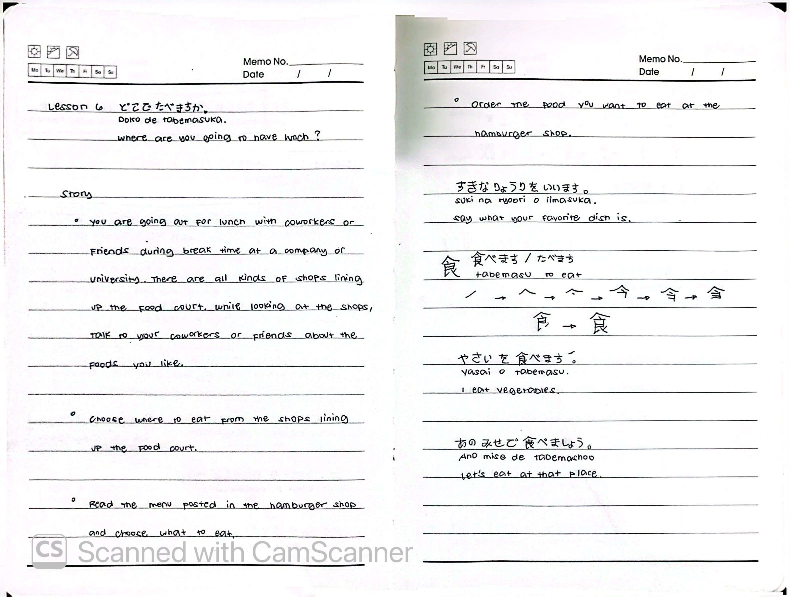
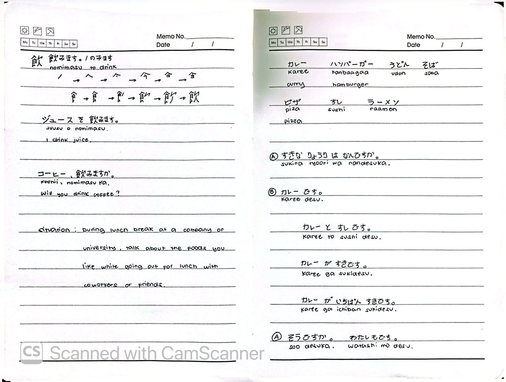

# 🎌 Lesson 6: どこで たべますか (Doko de tabemasu ka)

**Course:** Marugoto A1-1 (Katsudoo & Rikai)
**Topic:** Topic 3 — たべもの (Tabemono - Food)
**Mode:** かつどう (Katsudoo)
**Status:** 🚧 In Progress

---

## 🎯 Can-Do Objective
**Can-do 6:** Order the food you want to eat and say what your favorite dish is.
**Goal:** すきな りょうりを いいます (Say your favorite dish)

---

## 📖 Story: Lunch Break

**English Summary:**
You are going out for lunch with coworkers or friends during break time at a company or university. There are all kinds of shops lining up in the food court.

1. While looking at the shops, talk to your coworkers or friends about the foods you like.
2. Choose where to eat from the shops lining up the food court.
3. Read the menu posted in the hamburger shop and choose what to eat.
4. Order the food you want to eat at the hamburger shop.

**Situation:** During lunch break at a company or university, talk about the foods you like while going out for lunch with coworkers or friends.

---

## ✍️ Kanji Practice

### 食 (tabemasu) — Eat
**Stroke order:** ノ → へ → へ → 今 → 食 → 食

- やさいを 食べます。 (*Yasai o tabemasu.*) — I eat vegetables.
- あの みせで 食べましょう。 (*Ano mise de tabemashoo.*) — Let's eat at that place.

### 飲 (nomimasu) — Drink
**Stroke order:** ノ → へ → へ → 今 → 食 → 食

- ジュースを 飲みます。 (*Juusu o nomimasu.*) — I drink juice.
- コーヒー、飲みますか。 (*Koohi, nomimasu ka.*) — Will you drink coffee?

---

## 🍽️ Food Vocabulary (Dishes)

| Japanese | Romaji | English |
| :--- | :--- | :--- |
| カレー | *karee* | curry |
| ハンバーガー | *hanbaagaa* | hamburger |
| うどん | *udon* | udon |
| そば | *soba* | soba |
| ピザ | *piza* | pizza |
| すし | *sushi* | sushi |
| ラーメン | *raamen* | ramen |

---

## 💬 Grammar: すきな りょうりは なんですか

### Basic Sentences

| Japanese | Romaji | English |
| :--- | :--- | :--- |
| A) すきな りょうりは なんですか。 | *Sukina ryoori wa nan desu ka.* | What is your favorite dish? |
| B) カレー です。 | *Karee desu.* | It's curry. |
| カレーと すし です。 | *Karee to sushi desu.* | It's curry and sushi. |
| カレー が すきです。 | *Karee ga suki desu.* | I like curry. |
| カレー が いちばん すきです。 | *Karee ga ichiban suki desu.* | I like curry the most. |
| A) そうですか。わたしも です。 | *Soo desu ka. Watashi mo desu.* | Oh really? Me too. |

---

## 📝 Study Log & Additional Notes

- **2026-10-15:** Started Katsudoo Lesson 6. Learned kanji 食 (eat) and 飲 (drink), food dish vocabulary (カレー, ハンバーガー, うどん, etc.), and how to talk about your favorite dish.

---

## 📸 Handwritten Notes (Appendix)
> *Scanned pages from my physical study notebook.*

**Page 1 — Story, Kanji 食**

**Page 2 — Kanji 飲, Food Vocabulary & Favorite Dish**
