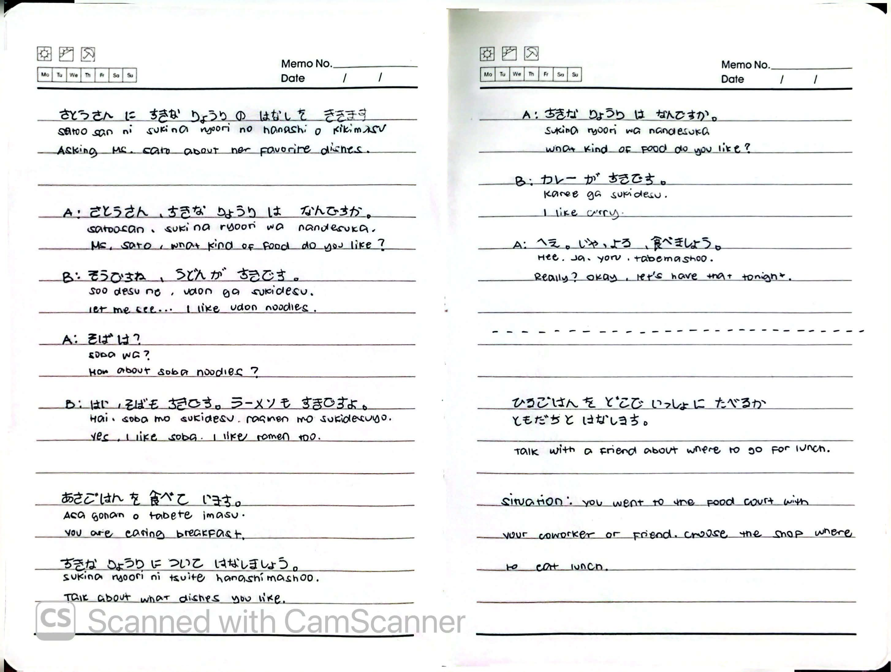
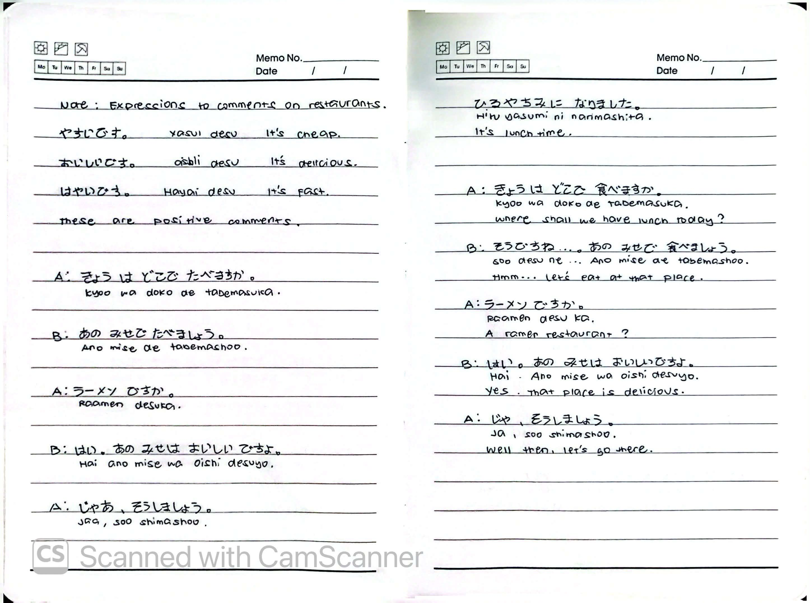
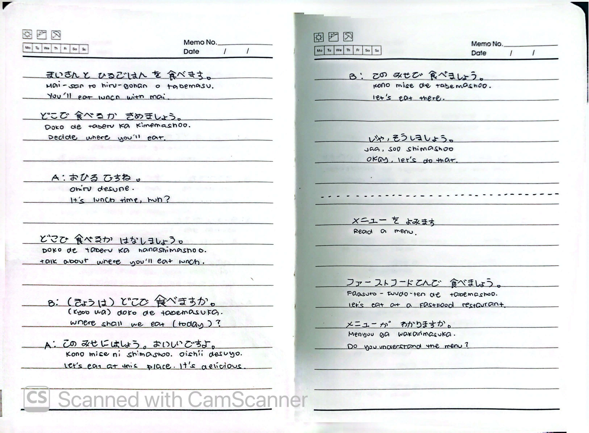
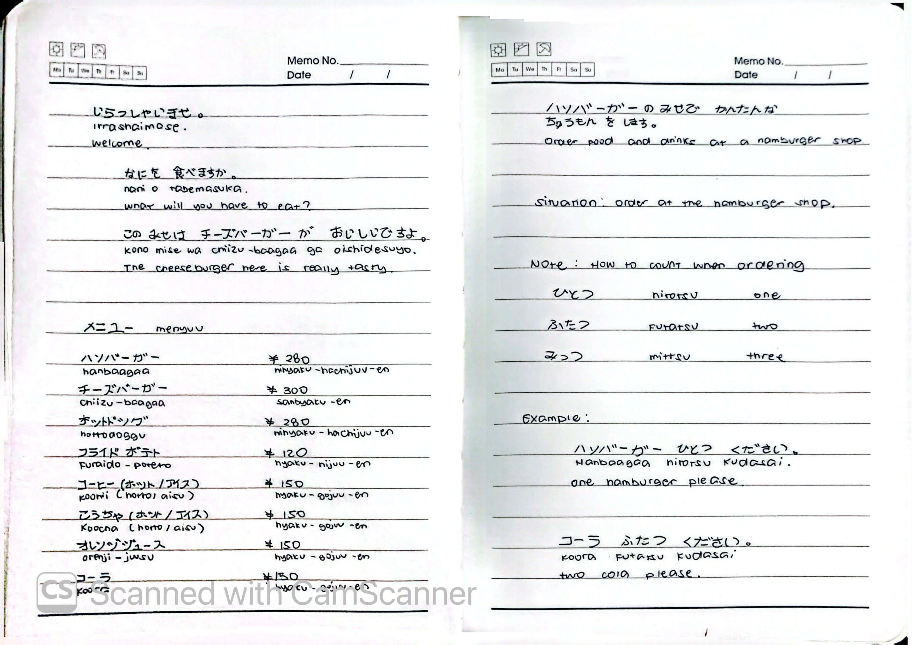
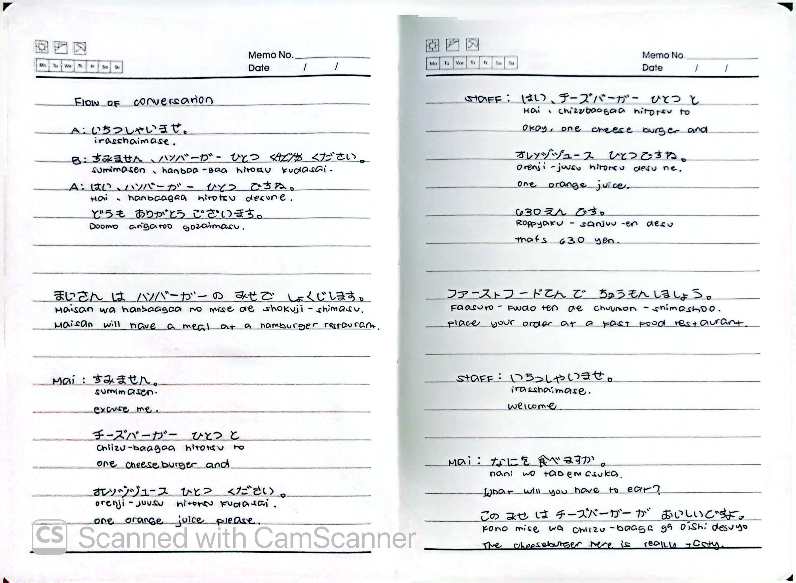
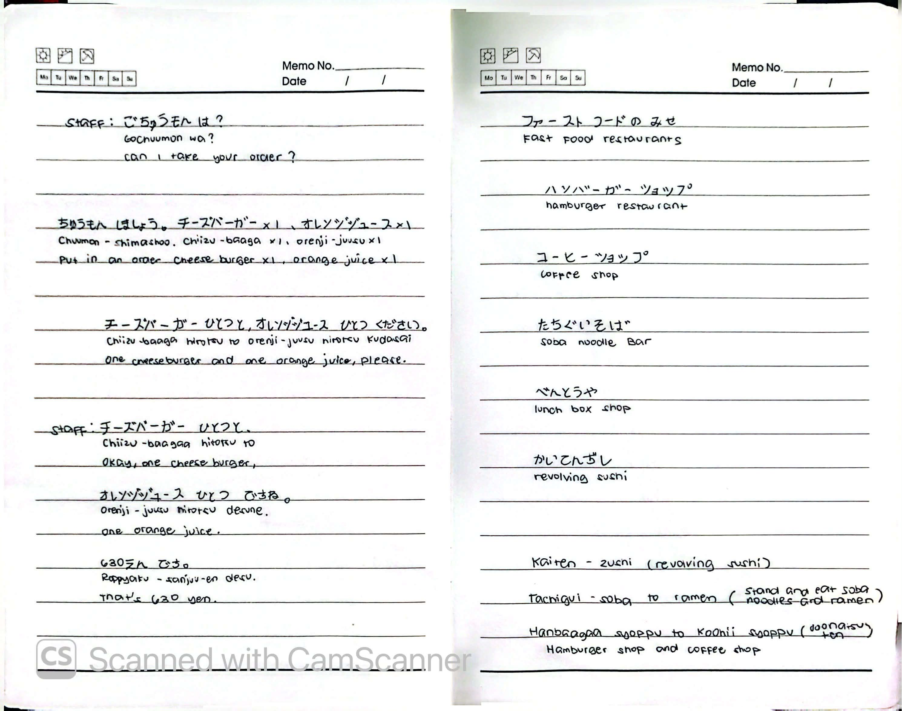

# 🎌 Lesson 6: どこで たべますか (Doko de tabemasu ka)

**Course:** Marugoto A1-1 (Katsudoo & Rikai)
**Topic:** Topic 3 — たべもの (Tabemono - Food)
**Mode:** かつどう (Katsudoo)
**Status:** ✅ Completed

---

## 🎯 Can-Do Objective
**Can-do 6:** Order the food you want to eat and say what your favorite dish is.
**Goal:** すきな りょうりを いいます (Say your favorite dish)

---

## 📖 Story: Lunch Break

**English Summary:**
You are going out for lunch with coworkers or friends during break time at a company or university. There are all kinds of shops lining up in the food court.

1. While looking at the shops, talk to your coworkers or friends about the foods you like.
2. Choose where to eat from the shops lining up the food court.
3. Read the menu posted in the hamburger shop and choose what to eat.
4. Order the food you want to eat at the hamburger shop.

**Situation:** During lunch break at a company or university, talk about the foods you like while going out for lunch with coworkers or friends.

---

## ✍️ Kanji Practice

### 食 (tabemasu) — Eat
**Stroke order:** ノ → へ → へ → 今 → 食 → 食
- やさいを 食べます。 (*Yasai o tabemasu.*) — I eat vegetables.

### 飲 (nomimasu) — Drink
**Stroke order:** ノ → へ → へ → 今 → 食 → 食
- ジュースを 飲みます。 (*Juusu o nomimasu.*) — I drink juice.

---

## 🍽️ Food Vocabulary (Dishes)

| Japanese | Romaji | English |
| :--- | :--- | :--- |
| カレー | *karee* | curry |
| ハンバーガー | *hanbaagaa* | hamburger |
| うどん | *udon* | udon |
| そば | *soba* | soba |
| ピザ | *piza* | pizza |
| すし | *sushi* | sushi |
| ラーメン | *raamen* | ramen |

### Fast Food Restaurant Types (ファーストフードの みせ)
| Japanese | Romaji | English |
| :--- | :--- | :--- |
| ハンバーガーショップ | *hanbaagaa shoppu* | hamburger restaurant |
| コーヒーショップ | *koohi shoppu* | coffee shop |
| たちぐいそば | *tachigui soba* | soba noodle bar (stand and eat) |
| べんとうや | *bentoo-ya* | lunch box shop |
| かいてんずし | *kaiten-zushi* | revolving sushi |

---

## 💬 Grammar: すきな りょうりは なんですか

| Japanese | Romaji | English |
| :--- | :--- | :--- |
| A) すきな りょうりは なんですか。 | *Sukina ryoori wa nan desu ka.* | What is your favorite dish? |
| B) カレー です。 | *Karee desu.* | It's curry. |
| カレーと すし です。 | *Karee to sushi desu.* | It's curry and sushi. |
| カレー が すきです。 | *Karee ga suki desu.* | I like curry. |
| カレー が いちばん すきです。 | *Karee ga ichiban suki desu.* | I like curry the most. |

---

## 🗣️ Practice Dialogues

### Dialogue 1: Asking Satou-san About Her Favorite Dishes
| Speaker | Japanese | Romaji | English |
| :--- | :--- | :--- | :--- |
| A | さとうさん、すきな りょうりは なんですか。 | *Satou-san, sukina ryoori wa nan desu ka.* | Ms. Sato, what kind of food do you like? |
| B | そうですね、うどんが すきです。 | *Soo desu ne, udon ga suki desu.* | Let me see... I like udon noodles. |
| A | そばは？ | *Soba wa?* | How about soba noodles? |
| B | はい、そばも すきです。ラーメンも すきですよ。 | *Hai, soba mo suki desu. Raamen mo suki desu yo.* | Yes, I like soba. I like ramen too. |

### Dialogue 2: Deciding Where to Eat
| Speaker | Japanese | Romaji | English |
| :--- | :--- | :--- | :--- |
| A | おひるですね。 | *Ohiru desu ne.* | It's lunch time, huh? |
| B | どこで たべるか きめましょう。 | *Doko de taberu ka kimemashoo.* | Decide where you'll eat. |
| A | きょうは どこで たべますか。 | *Kyoo wa doko de tabemasu ka.* | Where shall we eat today? |
| B | この みせに しましょう。おいしいですよ。 | *Kono mise ni shimashoo. Oishii desu yo.* | Let's eat at this place. It's delicious. |

---

## 🍔 Menu & Prices (Hamburger Shop)

| Item | Japanese | Romaji | Price |
| :--- | :--- | :--- | :--- |
| Hamburger | ハンバーガー | *hanbaagaa* | ¥280 |
| Cheeseburger | チーズバーガー | *chiizu-baagaa* | ¥300 |
| Potato | ポテト | *poteto* | ¥280 |
| Fried Potato | フライドポテト | *furaido-poteto* | ¥120 |
| Coffee (Hot/Iced) | コーヒー (ホット/アイス) | *koohi (hotto/aisu)* | ¥150 |
| Tea (Hot/Iced) | こうちゃ (ホット/アイス) | *koocha (hotto/aisu)* | ¥150 |
| Orange Juice | オレンジジュース | *orenji-juusu* | ¥150 |
| Cola | コーラ | *koora* | ¥150 |

---

## 🔢 Counting Items (ひとつ, ふたつ, みっつ)

When ordering items (not people), use the native Japanese counting system.

| Number | Japanese | Romaji |
| :---: | :--- | :--- |
| 1 | ひとつ | *hitotsu* |
| 2 | ふたつ | *futatsu* |
| 3 | みっつ | *mittsu* |

### Examples
| Japanese | Romaji | English |
| :--- | :--- | :--- |
| ハンバーガー ひとつ ください。 | *Hanbaagaa hitotsu kudasai.* | One hamburger, please. |
| コーラ ふたつ ください。 | *Koora futatsu kudasai.* | Two colas, please. |

---

## 🗣️ Ordering Flow & Expressions

**Staff:** いらっしゃいませ。 (*Irasshaimase.* — Welcome.)
**Staff:** ごちゅうもんは？ (*Gochuumon wa?* — Can I take your order?)
**Mai:** チーズバーガー ひとつと オレンジジュース ひとつ ください。 (*Chiizu-baagaa hitotsu to orenji-juusu hitotsu kudasai.* — One cheeseburger and one orange juice, please.)
**Staff:** チーズバーガー ひとつと オレンジジュース ひとつですね。630えん です。 (*Chiizu-baagaa hitotsu to orenji-juusu hitotsu desu ne. Roppyaku-sanjuu en desu.* — One cheeseburger and one orange juice. That's 630 yen.)
**Mai:** どうも ありがとうございます。 (*Doomo arigatoo gozaimasu.* — Thank you very much.)

### Useful Phrases
| Japanese | Romaji | English |
| :--- | :--- | :--- |
| いらっしゃいませ。 | *Irasshaimase.* | Welcome. |
| ごちゅうもんは？ | *Gochuumon wa?* | Can I take your order? |
| なにを たべますか。 | *Nani o tabemasu ka.* | What will you have to eat? |

---

## 📝 Study Log & Additional Notes

- **2026-10-15:** Started Katsudoo Lesson 6. Learned kanji 食 (eat) and 飲 (drink), food dish vocabulary, and how to talk about your favorite dish.
- **2026-10-16:** Learned how to ask about and comment on restaurants, and practiced lunch dialogues.
- **2026-10-17:** Learned how to order food at a fast-food restaurant, read a menu with prices, and use the counting system (ひとつ, ふたつ, みっつ).
- **2026-10-18:** Completed Katsudoo Lesson 6. Learned ordering expressions (ごちゅうもんは？) and types of fast-food restaurants.

---

## 📸 Handwritten Notes (Appendix)
> *Scanned pages from my physical study notebook.*

**Page 1 — Story, Kanji 食**

**Page 2 — Kanji 飲, Food Vocabulary & Favorite Dish**

**Page 3 — Satou-san Dialogue & Lunch Plans**

**Page 4 — Restaurant Comments & Choosing Lunch**

**Page 5 — Deciding Where to Eat**

**Page 6 — Menu Prices & Counting System**

**Page 7 — Ordering Dialogue Flow**

**Page 8 — Ordering Expressions & Restaurant Types**
