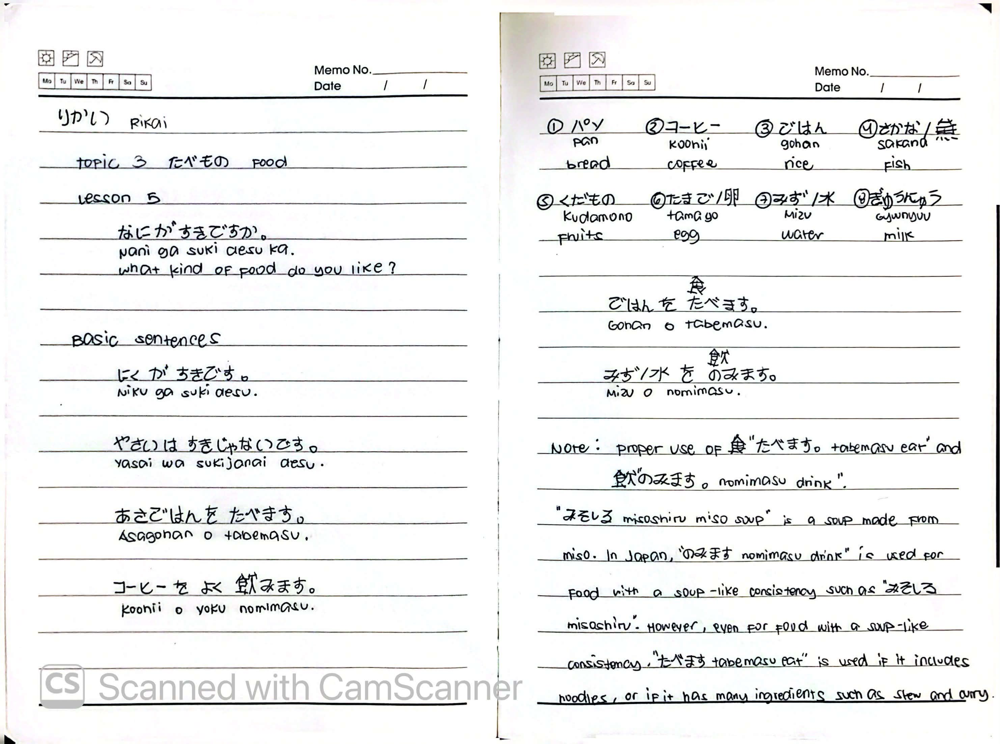
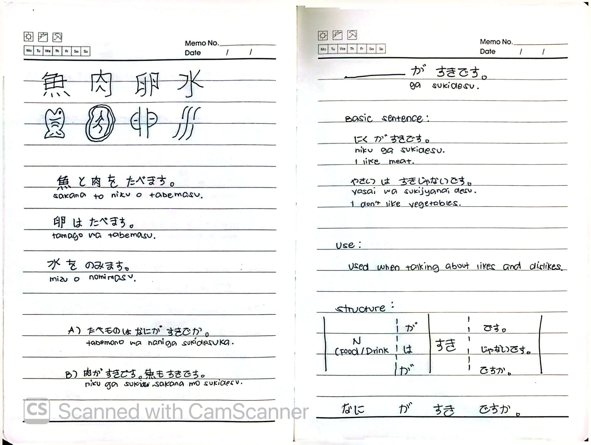
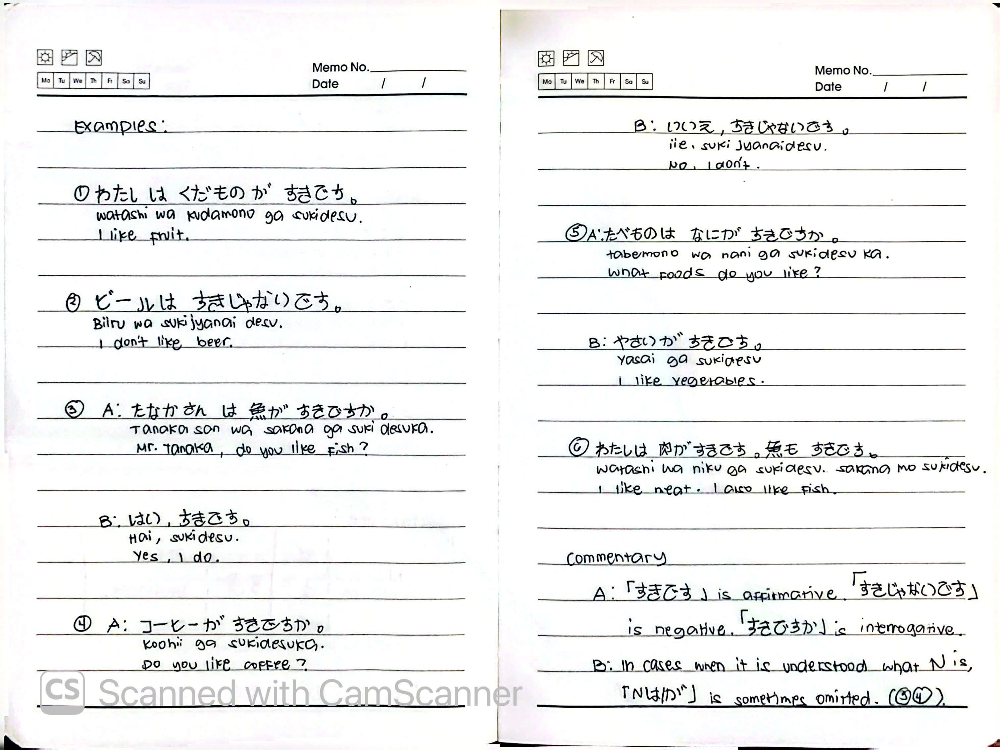
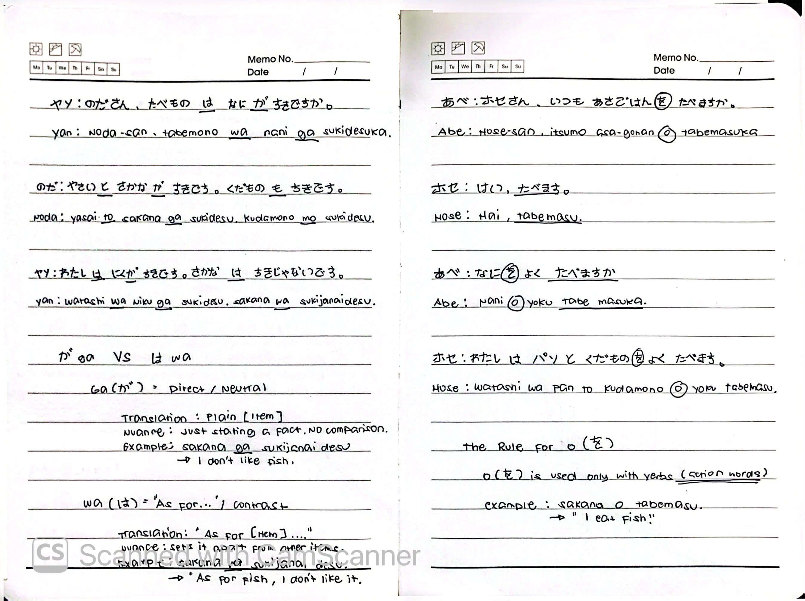
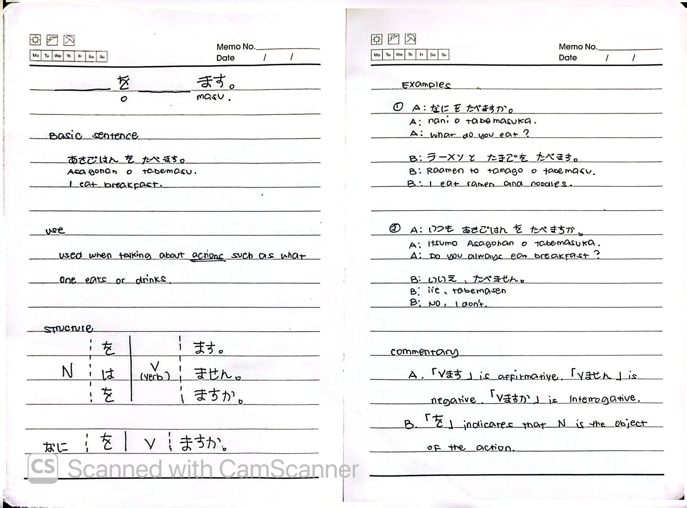
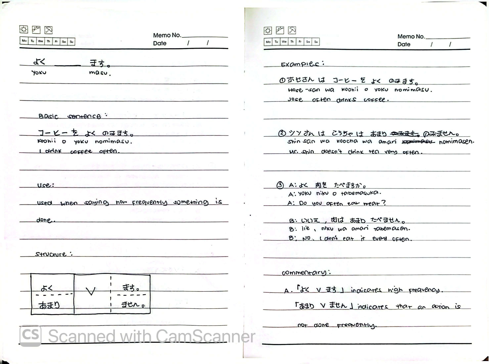
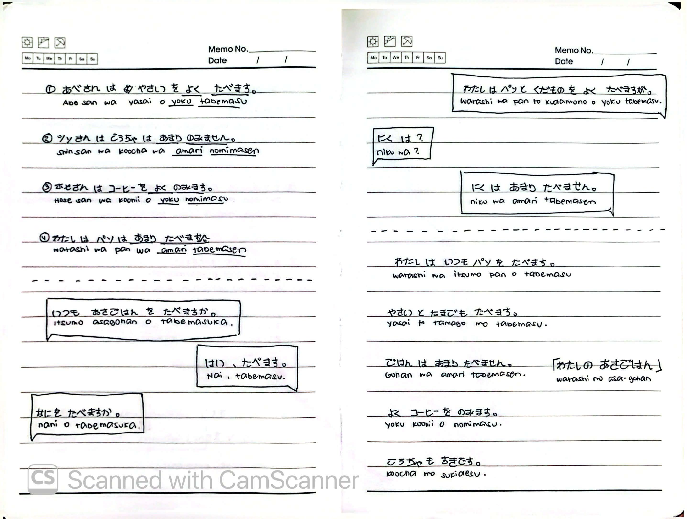

# 🎌 Rikai Lesson 5: なにが すきですか (Nani ga suki desu ka)

**Course:** Marugoto A1-1 (Katsudoo & Rikai)
**Topic:** Topic 3 — たべもの (Tabemono - Food)
**Mode:** りかい (Rikai)
**Status:** ✅ Completed

---

## 🎯 Can-Do Objective
**Can-do:** Talk about likes and dislikes, and understand the difference between eating and drinking.
**Goal:** すきな たべものについて はなします (Talk about your favorite foods)

---

## 🗣️ Basic Sentences

| Japanese | Romaji | English |
| :--- | :--- | :--- |
| にくが すきです。 | *Niku ga suki desu.* | I like meat. |
| やさいは すきじゃないです。 | *Yasai wa suki janai desu.* | I don't like vegetables. |
| あさごはんを たべます。 | *Asagohan o tabemasu.* | I eat breakfast. |
| コーヒーを よく のみます。 | *Koohi o yoku nomimasu.* | I often drink coffee. |

---

## 🍽️ Food & Drink Vocabulary

| Japanese | Romaji | English |
| :--- | :--- | :--- |
| パン | *pan* | bread |
| コーヒー | *koohi* | coffee |
| ごはん | *gohan* | rice |
| さかな | *sakana* | fish |
| くだもの | *kudamono* | fruits |
| たまご | *tamago* | egg |
| みず | *mizu* | water |
| ぎゅうにゅう | *gyuunyuu* | milk |
| ビール | *biiru* | beer |
| こうちゃ | *koocha* | English tea |

---

## ✍️ Kanji Practice

### 魚 (sakana) — Fish
### 肉 (niku) — Meat
### 卵 (tamago) — Egg
### 水 (mizu) — Water

**Example Sentences:**
* 魚と 肉を たべます。 (*Sakana to niku o tabemasu.*) — I eat fish and meat.
* 卵は たべます。 (*Tamago wa tabemasu.*) — I eat eggs.
* 水を のみます。 (*Mizu o nomimasu.*) — I drink water.

---

## 🗣️ Grammar: Likes & Dislikes (すきです / すきじゃないです)

### Use
Used when talking about **likes and dislikes**.

### Structure
N (food/drink) は / が すきです。 (affirmative)
が すきじゃないです。 (negative)
が すきですか。 (interrogative)

### Basic Sentences

| Japanese | Romaji | English |
| :--- | :--- | :--- |
| にくが すきです。 | *Niku ga suki desu.* | I like meat. |
| やさいは すきじゃないです。 | *Yasai wa suki janai desu.* | I don't like vegetables. |
| なにが すきですか。 | *Nani ga suki desu ka.* | What do you like? |

---

## ⚖️ Grammar: が (ga) vs は (wa)

Both particles can be used with すきです, but they have slightly different nuances.

| Particle | Nuance | Example | Translation |
| :---: | :--- | :--- | :--- |
| **が (ga)** | Direct / Neutral. Just stating a fact, no comparison. | さかな**が** すきじゃないです。 | I don't like fish. *(Just a plain fact)* |
| **は (wa)** | "As for..." / Contrast. Sets it apart from other items. | さかな**は** すきじゃないです。 | As for fish, I don't like it. *(Implies: but I might like other things)* |

---

## 🍽️ Grammar: Particle を (o) + Verbs

### Use
「を」is used only with **verbs (action words)**. It indicates that the noun is the **object** of the action (what you eat, drink, etc.).

### Structure
N は V (verb) ます。
N を V (verb) ません。
N を V (verb) ますか。
なに を V (verb) ますか。

### Examples

| # | Japanese | Romaji | English |
| :---: | :--- | :--- | :--- |
| ① | A: なにを たべますか。 | *A: Nani o tabemasu ka.* | A: What do you eat? |
|   | B: ラーメンと たまごを たべます。 | *B: Raamen to tamago o tabemasu.* | B: I eat ramen and eggs. |
| ② | A: いつも あさごはんを たべますか。 | *A: Itsumo asagohan o tabemasu ka.* | A: Do you always eat breakfast? |
|   | B: いいえ、たべません。 | *B: Iie, tabemasen.* | B: No, I don't. |

---

## ⏰ Grammar: Frequency Adverbs (よく / あまり)

### Use
Used when saying **how frequently something is done**.

### Structure
よく V ます。
あまり V ません。

| Adverb | Meaning | Used with |
| :--- | :--- | :--- |
| **よく** (*yoku*) | often | Affirmative verbs |
| **あまり** (*amari*) | not much / not often | Negative verbs |

### Examples

| # | Japanese | Romaji | English |
| :---: | :--- | :--- | :--- |
| ① | ほせさんは コーヒーを よく のみます。 | *Hose-san wa koohi o yoku nomimasu.* | Jose often drinks coffee. |
| ② | シンさんは こうちゃは あまり のみません。 | *Shin-san wa koocha wa amari nomimasen.* | Mr. Shin doesn't drink tea very often. |
| ③ | A: よく 肉を たべますか。 | *A: Yoku niku o tabemasu ka.* | A: Do you often eat meat? |
|   | B: いいえ、肉は あまり たべません。 | *B: Iie, niku wa amari tabemasen.* | B: No, I don't eat it very often. |

### Commentary
* 「よく V ます」indicates **high frequency**.
* 「あまり V ません」indicates that an action is **not done frequently**.

---

## 💬 Practice Examples

| # | Japanese | Romaji | English |
| :---: | :--- | :--- | :--- |
| ① | あべさんは やさいを よく たべます。 | *Abe-san wa yasai o yoku tabemasu.* | Abe often eats vegetables. |
| ② | シンさんは こうちゃは あまり のみません。 | *Shin-san wa koocha wa amari nomimasen.* | Shin doesn't drink tea very often. |
| ③ | ほせさんは コーヒーを よく のみます。 | *Hose-san wa koohi o yoku nomimasu.* | Hose often drinks coffee. |
| ④ | わたしは パンは あまり たべません。 | *Watashi wa pan wa amari tabemasen.* | I don't eat bread very often. |

### Breakfast Dialogue

| Speaker | Japanese | Romaji | English |
| :--- | :--- | :--- | :--- |
| — | いつも あさごはんを たべますか。 | *Itsumo asagohan o tabemasu ka.* | Do you always eat breakfast? |
| — | はい、たべます。 | *Hai, tabemasu.* | Yes, I do. |
| — | なにを たべますか。 | *Nani o tabemasu ka.* | What do you eat? |
| — | わたしは パンと くだものを よく たべます。 | *Watashi wa pan to kudamono o yoku tabemasu.* | I often eat bread and fruits. |
| — | にくは？ | *Niku wa?* | What about meat? |
| — | にくは あまり たべません。 | *Niku wa amari tabemasen.* | I don't eat meat very often. |

### My Breakfast (わたしの あさごはん)

| Japanese | Romaji | English |
| :--- | :--- | :--- |
| わたしは いつも パンを たべます。 | *Watashi wa itsumo pan o tabemasu.* | I always eat bread. |
| やさいと たまごも たべます。 | *Yasai to tamago mo tabemasu.* | I also eat vegetables and eggs. |
| ごはんは あまり たべません。 | *Gohan wa amari tabemasen.* | I don't eat rice very often. |
| よく コーヒーを のみます。 | *Yoku koohi o nomimasu.* | I often drink coffee. |
| こうちゃも すきです。 | *Koocha mo suki desu.* | I also like English tea. |

---

## 🗣️ Practice Dialogues

### Dialogue 1: Food Preferences (Yan & Noda)
| Speaker | Japanese | Romaji | English |
| :--- | :--- | :--- | :--- |
| ヤン | のださん、たべものは なにが すきですか。 | *Noda-san, tabemono wa nani ga suki desu ka.* | Noda, what food do you like? |
| のだ | やさいと さかなが すきです。くだものも すきです。 | *Yasai to sakana ga suki desu. Kudamono mo suki desu.* | I like vegetables and fish. I also like fruits. |
| ヤン | わたしは にくが すきです。さかなは すきじゃないです。 | *Watashi wa niku ga suki desu. Sakana wa suki janai desu.* | I like meat. As for fish, I don't like it. |

### Dialogue 2: Breakfast Habits (Abe & Hose)
| Speaker | Japanese | Romaji | English |
| :--- | :--- | :--- | :--- |
| あべ | ほせさん、いつも あさごはんを たべますか。 | *Hose-san, itsumo asagohan o tabemasu ka.* | Hose, do you always eat breakfast? |
| ほせ | はい、たべます。 | *Hai, tabemasu.* | Yes, I do. |
| あべ | なにを よく たべますか。 | *Nani o yoku tabemasu ka.* | What do you often eat? |
| ほせ | わたしは パンと くだものを よく たべます。 | *Watashi wa pan to kudamono o yoku tabemasu.* | I often eat bread and fruits. |

---

## 📝 Commentary & Key Notes

**A.** 「Vます」is **affirmative**, 「Vません」is **negative**, and 「Vますか」is **interrogative**.

**B.** 「を」indicates that N is the **object** of the action.

**C.** 「よく V ます」= high frequency. 「あまり V ません」= low frequency.

---

## 📝 Study Log & Additional Notes

- **2026-10-09:** Started Rikai Lesson 5. Learned how to express likes and dislikes (すきです / すきじゃないです), and the difference between たべます (eat) and のみます (drink).
- **2026-10-11:** Learned the particle を with verbs, the difference between が and は in the context of likes/dislikes, and practiced asking about daily habits.
- **2026-10-13:** Completed Rikai Lesson 5. Learned frequency adverbs よく (often) and あまり (not much), practiced breakfast dialogues, and wrote a sample breakfast description.

---

## 📸 Handwritten Notes (Appendix)
> *Scanned pages from my physical study notebook.*

**Page 1 — Intro, Basic Sentences & Vocabulary**

**Page 2 — Kanji Practice & すきです Structure**

**Page 3 — Examples & Commentary**

**Page 4 — Yan & Noda Dialogue + が vs は**

**Page 5 — Abe & Hose Dialogue + を Particle & Examples**

**Page 6 — Frequency Adverbs よく / あまり**

**Page 7 — Practice Examples & Breakfast Description**
