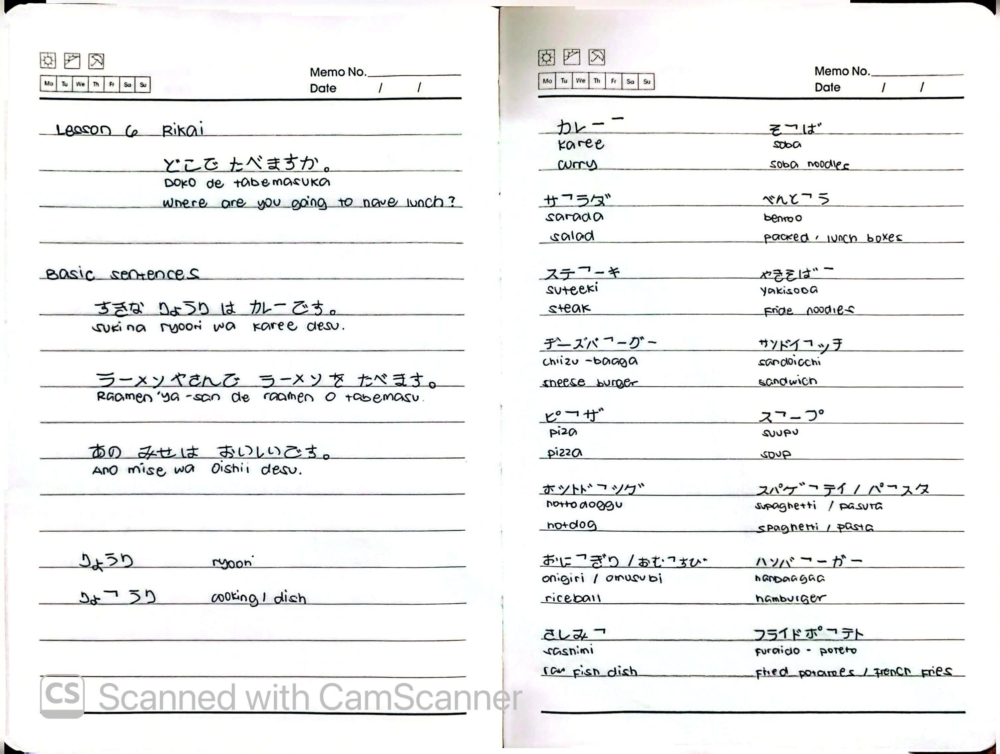
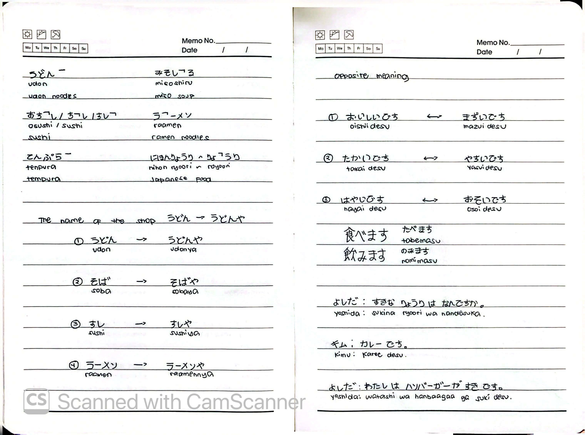
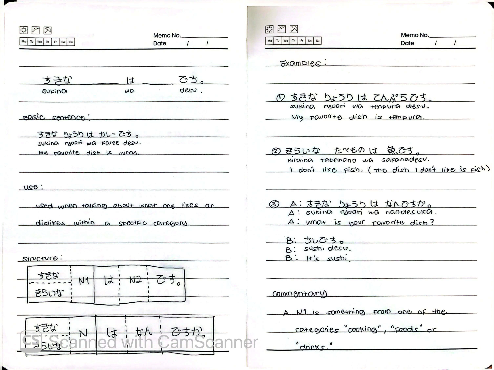

# 🎌 Rikai Lesson 6: どこで たべますか (Doko de tabemasu ka)

**Course:** Marugoto A1-1 (Katsudoo & Rikai)
**Topic:** Topic 3 — たべもの (Tabemono - Food)
**Mode:** りかい (Rikai)
**Status:** 🚧 In Progress

---

## 🎯 Can-Do Objective
**Can-do:** Talk about what you like or dislike within a specific category, and read shop names.
**Goal:** すきな りょうりを はなします (Talk about your favorite dishes)

---

## 🗣️ Basic Sentences

| Japanese | Romaji | English |
| :--- | :--- | :--- |
| すきな りょうりは カレーです。 | *Sukina ryoori wa karee desu.* | My favorite dish is curry. |
| ラーメンやさんで ラーメンを たべます。 | *Raamen-ya-san de raamen o tabemasu.* | Eat ramen at a ramen shop. |
| あの みせは おいしいです。 | *Ano mise wa oishii desu.* | That shop is delicious. |

---

## 🍽️ Vocabulary

### Cooking & Dishes
| Japanese | Romaji | English |
| :--- | :--- | :--- |
| りょうり | *ryoori* | cooking / dish |
| にほんりょうり / わしょく | *Nihon-ryoori / washoku* | Japanese food |
| カレー | *karee* | curry |
| そば | *soba* | soba noodles |
| うどん | *udon* | udon noodles |
| ラーメン | *raamen* | ramen noodles |
| やきそば | *yakisoba* | fried noodles |
| スパゲッティ / パスタ | *supagetti / pasuta* | spaghetti / pasta |
| おすし / すし | *osushi / sushi* | sushi |
| さしみ | *sashimi* | raw fish dish |
| てんぷら | *tenpura* | tempura |
| すきやき | *sukiyaki* | sukiyaki |
| ステーキ | *suteeki* | steak |
| ハンバーガー | *hanbaagaa* | hamburger |
| チーズバーガー | *chiizu-baagaa* | cheeseburger |
| サンドイッチ | *sandoitchi* | sandwich |
| ピザ | *piza* | pizza |
| サラダ | *sarada* | salad |
| スープ | *suupu* | soup |
| みそしる | *misoshiru* | miso soup |
| べんとう | *bentoo* | packed lunch boxes |
| おにぎり / おむすび | *onigiri / omusubi* | rice ball |
| ポテト | *poteto* | potato |
| フライドポテト | *furaido-poteto* | fried potatoes / french fries |

### Shop Names (～や)
Adding 「や」 (*ya*) to a food name means "shop/store that sells that food."

| Food | Shop |
| :--- | :--- |
| うどん (*udon*) | → うどんや (*udon-ya* - udon shop) |
| そば (*soba*) | → そばや (*soba-ya* - soba shop) |
| すし (*sushi*) | → すしや (*sushi-ya* - sushi shop) |
| ラーメン (*raamen*) | → ラーメンや (*raamen-ya* - ramen shop) |

---

## ⚖️ Opposite Meanings (Adjectives)

| Affirmative | Negative / Opposite |
| :--- | :--- |
| おいしいです (*oishii desu*) - delicious | まずいです (*mazui desu*) - tastes bad |
| たかいです (*takai desu*) - expensive | やすいです (*yasui desu*) - cheap |
| はやいです (*hayai desu*) - fast | おそいです (*osoi desu*) - slow |

---

## 🔑 Grammar: すきな / きらいな + Noun

### Use
Used when talking about **what one likes or dislikes within a specific category** (e.g., cooking, foods, drinks).

### Structure
すきな / きらいな N1 は N2 です。
すきな / きらいな N は なん ですか。

### Examples

| # | Japanese | Romaji | English |
| :---: | :--- | :--- | :--- |
| ① | すきな りょうりは てんぷらです。 | *Sukina ryoori wa tenpura desu.* | My favorite dish is tempura. |
| ② | きらいな たべものは さかなです。 | *Kiraina tabemono wa sakana desu.* | I don't like fish. (The dish I don't like is fish) |
| ③ | A: すきな りょうりは なんですか。 | *A: Sukina ryoori wa nan desu ka.* | A: What is your favorite dish? |
|   | B: すしです。 | *B: Sushi desu.* | B: It's sushi. |

### Dialogue Example
| Speaker | Japanese | Romaji | English |
| :--- | :--- | :--- | :--- |
| よしだ | すきな りょうりは なんですか。 | *Sukina ryoori wa nan desu ka.* | What is your favorite dish? |
| キム | カレーです。 | *Karee desu.* | It's curry. |
| よしだ | わたしは ハンバーガーが すきです。 | *Watashi wa hanbaagaa ga suki desu.* | I like hamburgers. |

### Commentary
N1 is something from one of the categories: "cooking", "foods", or "drinks".

---

## 📝 Study Log & Additional Notes

- **2026-10-21:** Started Rikai Lesson 6. Learned extended food vocabulary, shop names using ～や, opposite adjectives (おいしい/まずい, たかい/やすい, はやい/おそい), and how to use すきな / きらいな before a noun.

---

## 📸 Handwritten Notes (Appendix)
> *Scanned pages from my physical study notebook.*

**Page 1 — Basic Sentences & Food Vocabulary**

**Page 2 — Shop Names & Opposite Adjectives**

**Page 3 — すきな / きらいな + Noun Grammar**
