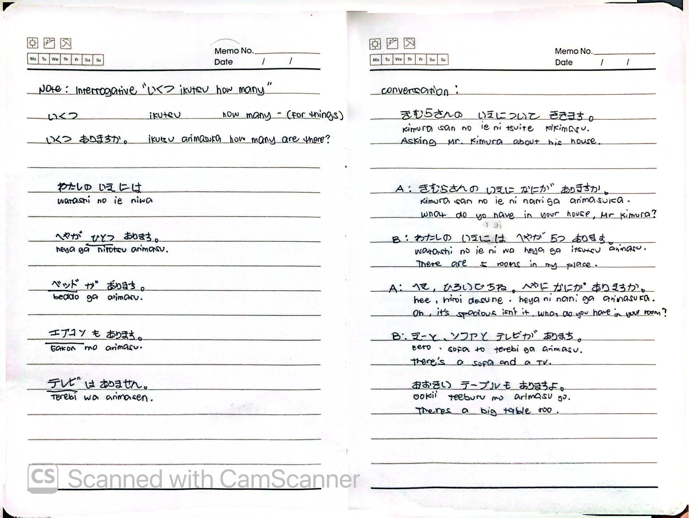
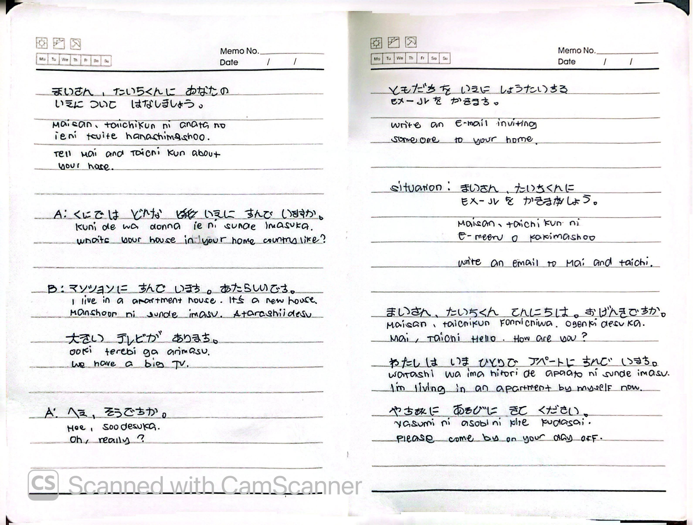
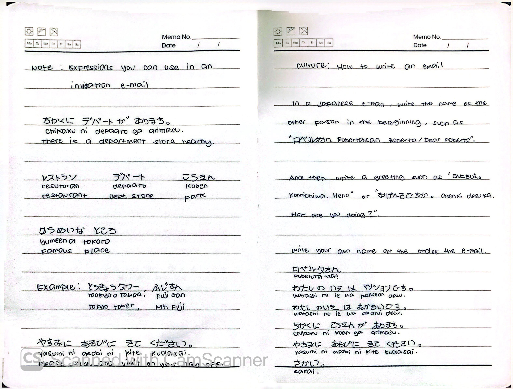

# 🎌 Lesson 7: へやが 3つ あります (Heya ga mittsu arimasu)

**Course:** Marugoto A1-1 (Katsudoo & Rikai)
**Topic:** Topic 4 — いえ (Ie - Home)
**Mode:** かつどう (Katsudoo)
**Status:** ✅ Completed

---

## 🎯 Can-Do Objective
**Can-do 7:** Say what kind of home you live in and what things are in it.
**Goals:** 
- どんな いえに すんでいますか いいます (Say what kind of home you live in)
- いえに なにが あるか いいます (Say what you have in your home)

---

## 📖 Story: Tell what your home is like

**Culture: Japanese House**
* **アパート (apaato)** and **マンション (manshon)** are both residential complexes. In general, a small-scale complex is an "apaato" and a large-scale one is a "manshon".
* "アパート" is derived from the English word "apartment" and is usually a 2- to 3-story building.
* "マンション" comes from the word "mansion", but it actually means a residential complex.
* **いっこだて (ikkodate - detached house)** is a private residence, distinguished from a residential complex.

---

## 🏠 Vocabulary

### Types of Homes & Rooms
| Japanese | Romaji | English |
| :--- | :--- | :--- |
| いえ | *ie* | house / home |
| へや | *heya* | room |
| アパート | *apaato* | apartment (small complex) |
| マンション | *manshon* | condominium (large complex) |
| いっこだて | *ikkodate* | detached house |

### Objects in a Home
| Japanese | Romaji | English |
| :--- | :--- | :--- |
| テレビ | *terebi* | TV |
| エアコン | *eakon* | air conditioner |
| ベッド | *beddo* | bed |
| テーブル | *teeburu* | table |
| ソファ | *sofa* | sofa |
| いす | *isu* | chair |

### Places in Town (Nearby)
| Japanese | Romaji | English |
| :--- | :--- | :--- |
| レストラン | *resutoran* | restaurant |
| デパート | *depaato* | department store |
| こうえん | *kooen* | park |
| ゆうめいな ところ | *yuumeena tokoro* | famous place |
| ちかく | *chikaku* | nearby |

---

## 🔢 Counting Objects & Asking "How Many"

### Counting Items (ひとつ, ふたつ...)
| Number | Japanese | Romaji |
| :---: | :--- | :--- |
| 1 | ひとつ | *hitotsu* |
| 2 | ふたつ | *futatsu* |
| 3 | みっつ | *mittsu* |
| 4 | よっつ | *yottsu* |
| 5 | いつつ | *itsutsu* |
| 6 | むっつ | *muttsu* |

### Interrogative: いくつ (ikutsu)
**Note:** Used for asking "how many" for things.
* いくつ ありますか。 (*Ikutsu arimasu ka.*) — How many are there?

---

## 💬 Practice Sentences

| Japanese | Romaji | English |
| :--- | :--- | :--- |
| わたしの いえには へやが いつつ あります。 | *Watashi no ie ni wa heya ga itsutsu arimasu.* | There are 5 rooms in my house. |
| ベッドが あります。 | *Beddo ga arimasu.* | There is a bed. |
| エアコンも あります。 | *Eakon mo arimasu.* | There is also an air conditioner. |
| テレビは ありません。 | *Terebi wa arimasen.* | There is no TV. |

---

## 🗣️ Dialogue: Asking Mr. Kimura About His House

| Speaker | Japanese | Romaji | English |
| :--- | :--- | :--- | :--- |
| A | きむらさんの いえに なにが ありますか。 | *Kimura-san no ie ni nani ga arimasu ka.* | What do you have in your house, Mr. Kimura? |
| B | わたしの いえには へやが 5つ あります。 | *Watashi no ie ni wa heya ga itsutsu arimasu.* | There are 5 rooms in my place. |
| A | へえ、ひろいですね。へやに なにが ありますか。 | *Hee, hiroi desu ne. Heya ni nani ga arimasu ka.* | Oh, it's spacious isn't it. What do you have in your room? |
| B | ベッド、ソファと テレビが あります。 | *Beddo, sofa to terebi ga arimasu.* | There's a bed, a sofa, and a TV. |
| B | おおきい テーブルも ありますよ。 | *Ookii teeburu mo arimasu yo.* | There's a big table too. |

### Dialogue: Telling Mai & Taichi About Your House
| Speaker | Japanese | Romaji | English |
| :--- | :--- | :--- | :--- |
| A | くにでは どんな いえに すんで（い）ますか。 | *Kuni de wa donna ie ni sunde (i)masu ka.* | What kind of house do you live in in your country? |
| B | マンションに すんで います。あたらしいです。おおきい テレビが あります。 | *Manshon ni sunde imasu. Atarashii desu. Ookii terebi ga arimasu.* | I live in an apartment house. It's a new house. We have a big TV. |
| A | へえ、そうですか。 | *Hee, soo desu ka.* | Oh, really? |

---

## ✉️ Writing an Invitation Email (メールを かきます)

### Situation
Write an email inviting someone to your home (e.g., Mai-san and Taichi-kun).

### Email Vocabulary & Expressions
* やすみに あそびに きて ください。 (*Yasumi ni asobi ni kite kudasai.*) — Please come and visit on your day off.
* ちかくに デパートが あります。 (*Chikaku ni depaato ga arimasu.*) — There is a department store nearby.
* Famous places: とうきょうタワー (*Tookyoo Tawaa*), ふじさん (*Fuji-san*).

### Culture: How to Write a Japanese Email
1. Write the name of the other person at the beginning (e.g., 「ロベルタさん Roberta-san」).
2. Write a greeting such as 「こんにちは」(*Konnichiwa*) or 「おげんきですか」(*Ogenki desu ka*).
3. Write your own name at the end.

### Email Example
> ロベルタさん
> こんにちは。
> わたしの いえは マンションです。
> わたしの いえは あかるいです。
> ちかくに こうえんが あります。
> やすみに あそびに きて ください。
> 
> さとう

---

## 📝 Study Log & Additional Notes

- **2026-10-25:** Started Katsudoo Lesson 7. Learned types of homes, home-related adjectives, and counting objects.
- **2026-10-27:** Learned the interrogative いくつ (how many), how to describe what is in a room, and how to write an invitation email in Japanese.
- **2026-10-29:** Completed Katsudoo Lesson 7.

---

## 📸 Handwritten Notes (Appendix)
> *Scanned pages from my physical study notebook.*

**Page 1 — Intro & Culture**

**Page 2 — Adjectives & Ueda-san Conversation**

**Page 3 — House Items & Counting**

**Page 4 — いくつ & Kimura Conversation**

**Page 5 — Telling Mai/Taichi & Email Intro**

**Page 6 — Email Vocabulary & Culture**
