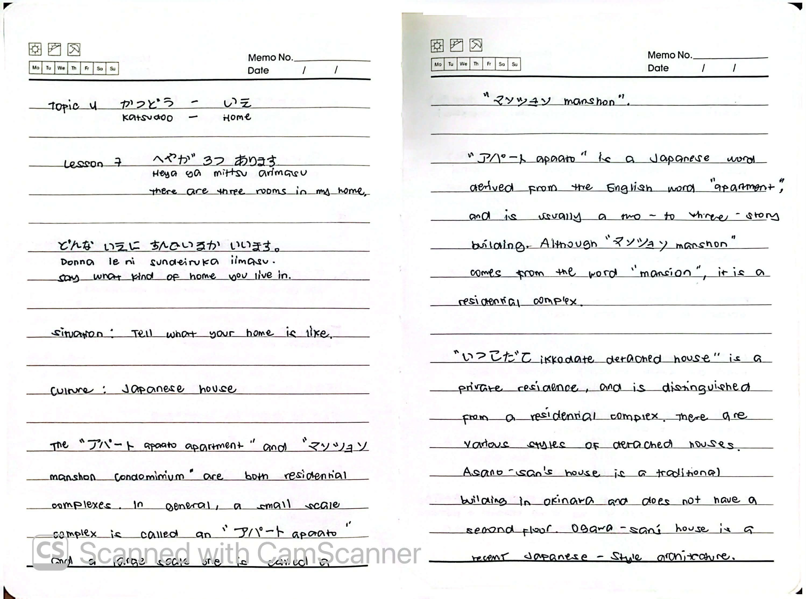
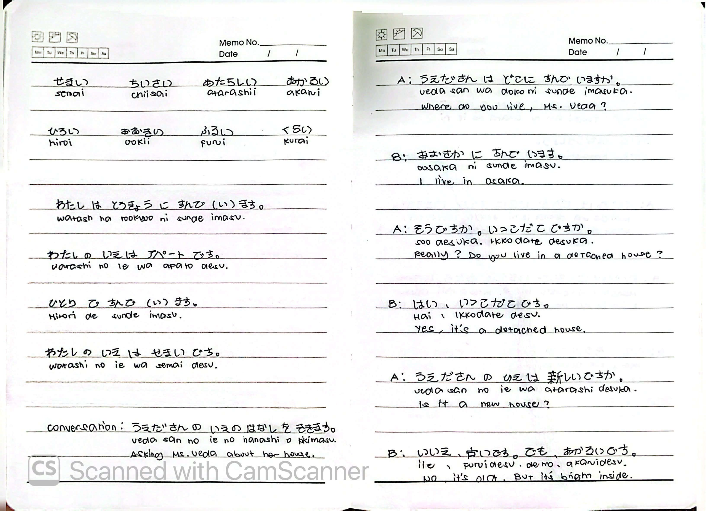
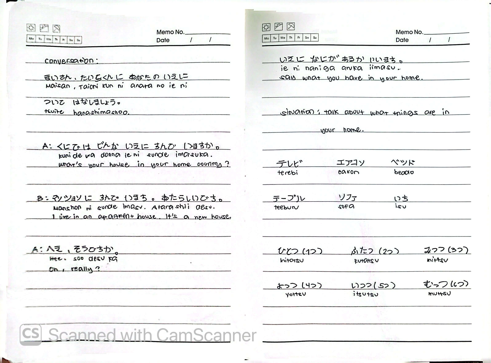

# 🎌 Lesson 7: へやが 3つ あります (Heya ga mittsu arimasu)

**Course:** Marugoto A1-1 (Katsudoo & Rikai)
**Topic:** Topic 4 — いえ (Ie - Home)
**Mode:** かつどう (Katsudoo)
**Status:** 🚧 In Progress

---

## 🎯 Can-Do Objective
**Can-do 7:** Say what kind of home you live in and what things are in it.
**Goals:** 
- どんな いえに すんでいますか いいます (Say what kind of home you live in)
- いえに なにが あるか いいます (Say what you have in your home)

---

## 📖 Story: Tell what your home is like

**Culture: Japanese House**
* **アパート (apaato)** and **マンション (manshon)** are both residential complexes. In general, a small-scale complex is an "apaato" and a large-scale one is a "manshon".
* "アパート" is derived from the English word "apartment" and is usually a 2- to 3-story building.
* "マンション" comes from the word "mansion", but it actually means a residential complex.
* **いっこだて (ikkodate - detached house)** is a private residence, distinguished from a residential complex. There are various styles of detached houses. 
  * Asano-san's house is a traditional building in Okinawa and does not have a second floor. 
  * Ogawa-san's house is a recent Japanese-style architecture.

---

## 🏠 Vocabulary

### Types of Homes
| Japanese | Romaji | English |
| :--- | :--- | :--- |
| いえ | *ie* | house / home |
| へや | *heya* | room |
| アパート | *apaato* | apartment (small complex) |
| マンション | *manshon* | condominium (large complex) |
| いっこだて | *ikkodate* | detached house |

### Objects in a Home
| Japanese | Romaji | English |
| :--- | :--- | :--- |
| テレビ | *terebi* | TV |
| エアコン | *eakon* | air conditioner |
| ベッド | *beddo* | bed |
| テーブル | *teeburu* | table |
| ソファ | *sofa* | sofa |
| いす | *isu* | chair |

### Adjectives
| Japanese | Romaji | English | Opposite |
| :--- | :--- | :--- | :--- |
| せまい | *semai* | narrow / small | ひろい (*hiroi* - spacious) |
| ちいさい | *chiisai* | small | おおきい (*ookii* - big) |
| あたらしい | *atarashii* | new | ふるい (*furui* - old) |
| あかるい | *akarui* | bright | くらい (*kurai* - dark) |

---

## 🔢 Counting Items (ひとつ, ふたつ...)

When counting objects (like rooms or furniture), use the native Japanese counting system.

| Number | Japanese | Romaji |
| :---: | :--- | :--- |
| 1 | ひとつ | *hitotsu* |
| 2 | ふたつ | *futatsu* |
| 3 | みっつ | *mittsu* |
| 4 | よっつ | *yottsu* |
| 5 | いつつ | *itsutsu* |
| 6 | むっつ | *muttsu* |

---

## 💬 Practice Sentences

| Japanese | Romaji | English |
| :--- | :--- | :--- |
| わたしは とうきょうに すんで(い)ます。 | *Watashi wa Tookyoo ni sunde (i)masu.* | I live in Tokyo. |
| わたしの いえは アパートです。 | *Watashi no ie wa apaato desu.* | My house is an apartment. |
| ひろい ところに すんで(い)ます。 | *Hiroi tokoro ni sunde (i)masu.* | I live in a spacious place. |
| わたしの いえは せまいです。 | *Watashi no ie wa semai desu.* | My house is narrow/small. |

---

## 🗣️ Dialogue: Asking Ueda-san About Her House

| Speaker | Japanese | Romaji | English |
| :--- | :--- | :--- | :--- |
| A | うえださんは どこに すんで いますか。 | *Ueda-san wa doko ni sunde imasu ka.* | Where do you live, Ms. Ueda? |
| B | おおさかに すんで います。 | *Oosaka ni sunde imasu.* | I live in Osaka. |
| A | そうですか。いっこだてですか。 | *Soo desu ka. Ikkodate desu ka.* | Really? Do you live in a detached house? |
| B | はい、いっこだてです。 | *Hai, ikkodate desu.* | Yes, it's a detached house. |
| A | うえださんの いえは あたらしいですか。 | *Ueda-san no ie wa atarashii desu ka.* | Is it a new house? |
| B | いいえ、ふるいです。でも、あかるいです。 | *Iie, furui desu. Demo, akarui desu.* | No, it's old. But it's bright inside. |

### Follow-up Dialogue (Country vs. Current Home)
| Speaker | Japanese | Romaji | English |
| :--- | :--- | :--- | :--- |
| A | くにでは どんな いえに すんでいましたか。 | *Kuni de wa donna ie ni sunde imashita ka.* | What kind of house did you live in in your country? |
| B | マンションに すんでいました。あたらしいです。 | *Manshon ni sunde imashita. Atarashii desu.* | I lived in an apartment complex. It's new. |
| A | へえ、そうですか。 | *Hee, soo desu ka.* | Oh, really? |

---

## 📝 Study Log & Additional Notes

- **2026-10-25:** Started Topic 4 (Katsudoo Lesson 7). Learned types of homes (アパート, マンション, いっこだて), home-related adjectives (せまい, ひろい, etc.), how to ask/talk about where someone lives, and counting objects (ひとつ, ふたつ...).

---

## 📸 Handwritten Notes (Appendix)
> *Scanned pages from my physical study notebook.*

**Page 1 — Intro & Culture**

**Page 2 — Adjectives & Ueda-san Conversation**

**Page 3 — House Items & Counting**
