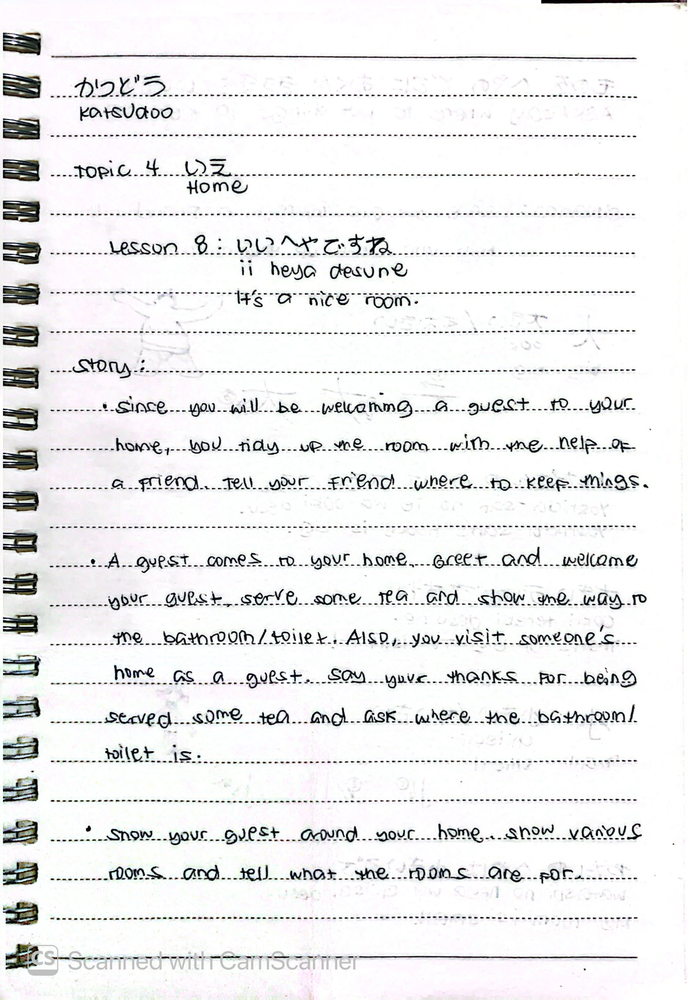
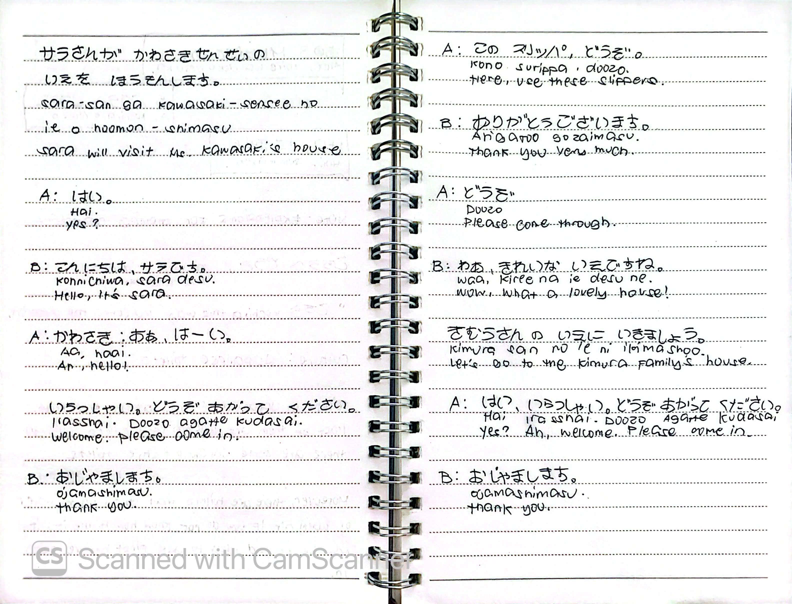
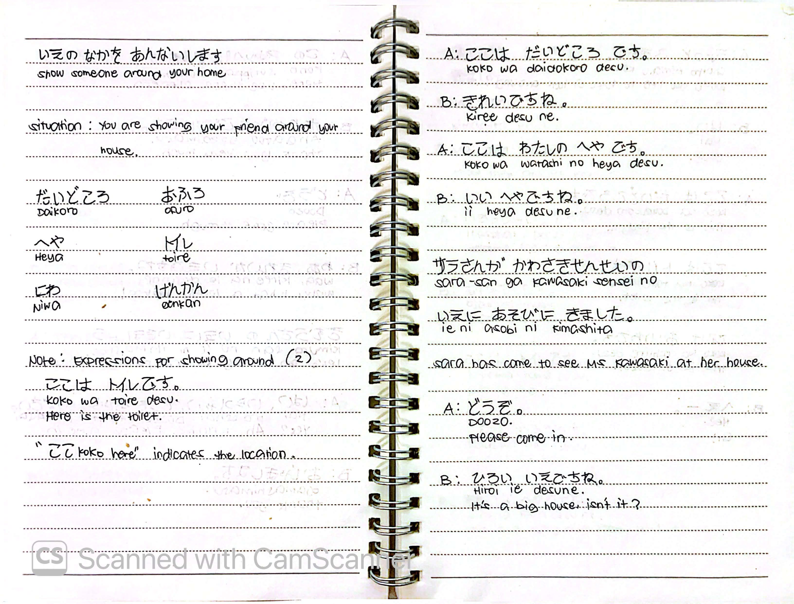
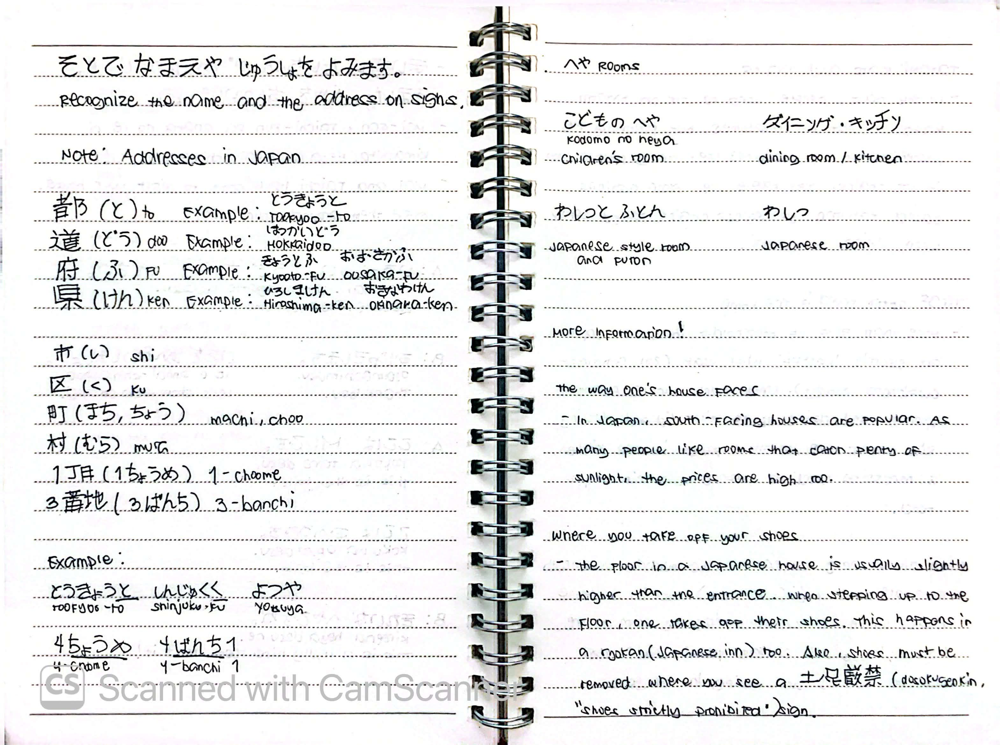
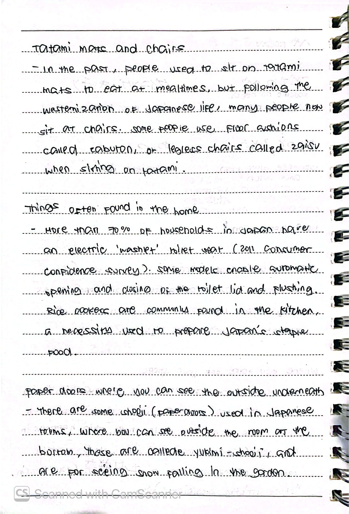

# 🎌 Lesson 8: いいへやですね (Ii heya desu ne)

**Course:** Marugoto A1-1 (Katsudoo & Rikai)
**Topic:** Topic 4 — いえ (Ie - Home)
**Mode:** かつどう (Katsudoo)
**Status:** ✅ Completed

---

## 🎯 Can-Do Objective
**Can-do 8:** Welcome a guest and show them around your home.
**Goal:** いえに ひとを しょうたいします (Invite someone to your house)

---

## 📖 Story: Welcoming a Guest

**Situation:**
1. Since you will be welcoming a guest to your home, you tidy up the room with the help of a friend. Tell your friend where to keep things.
2. A guest comes to your home. Greet and welcome your guest, serve some tea, and show the way to the bathroom/toilet. Also, you visit someone's home as a guest. Say your thanks for being served some tea and ask where the bathroom/toilet is.
3. Show your guest around your home. Show various rooms and tell what the rooms are for.

---

## ✍️ Kanji Practice

### 大 (ookii) — Big
* よしださんの いえは 大きいです。 (*Yoshida-san no ie wa ookii desu.*) — Yoshida-san's house is big.

### 小 (chiisai) — Small
* わたしの へやは 小さいです。 (*Watashi no heya wa chiisai desu.*) — My room is small.

### 新 (atarashii) — New
* この ベッドは 新しいです。 (*Kono beddo wa atarashii desu.*) — This bed is new.

### 古 (furui) — Old
* この にんぎょうは 古いです。 (*Kono ningyoo wa furui desu.*) — This doll is old.

---

## 📦 Vocabulary: Objects, Rooms & Locations

### Objects
| Japanese | Romaji | English |
| :--- | :--- | :--- |
| ほん | *hon* | book |
| しゃしん | *shashin* | photo |
| テーブル | *teeburu* | table |
| カップ | *kappu* | cup |
| にんぎょう | *ningyoo* | doll |
| はこ | *hako* | box |
| とけい | *tokee* | clock |
| たな | *tana* | shelf / rack |
| ファイル | *fairu* | file |
| スリッパ | *surippa* | slippers |

### Rooms & Areas
| Japanese | Romaji | English |
| :--- | :--- | :--- |
| だいどころ | *daidokoro* | kitchen |
| おふろ | *ofuro* | bath / bathroom |
| へや | *heya* | room |
| こどもの へや | *kodomo no heya* | children's room |
| ダイニング・キッチン | *dainingu-kicchin* | dining room / kitchen |
| わしつ | *washitsu* | Japanese-style room |
| トイレ | *toire* | toilet |
| にわ | *niwa* | garden |
| げんかん | *genkan* | entrance |
| おしいれ | *oshiire* | closet |

### Location Words
**Structure:** `[Noun] の [Location]`

| Japanese | Romaji | English |
| :--- | :--- | :--- |
| うえ | *ue* | on top of / above |
| なか | *naka* | inside / in |
| した | *shita* | under / below |
| よこ | *yoko* | beside / next to |

---

## 🗣️ Key Phrases & Grammar

### Asking "What is this?"
| Japanese | Romaji | English |
| :--- | :--- | :--- |
| これは なんですか。 | *Kore wa nan desu ka.* | What is this? |
| かんこくの にんぎょうです。 | *Kankoku no ningyoo desu.* | It's a Korean doll. |

### Particle の (Origin/Production)
`(Country name) の (Noun)` indicates where the noun belonged or where it was produced.
* ロシアの にんぎょう (*Roshia no ningyoo*) — Russian doll

### Showing Around the House
| Japanese | Romaji | English |
| :--- | :--- | :--- |
| ここは トイレです。 | *Koko wa toire desu.* | Here is the toilet. |
| いえの なかを あんないします。 | *Ie no naka o annai shimasu.* | Show someone around your home. |
| ちょっと みますか。 | *Chotto mimasu ka.* | Would you like to take a look around? |

---

## 🗺️ Reading Japanese Addresses

**Note:** まちで なまえや じゅうしょを よみます。 (*Recognize the name and the address on signs.*)

### Prefecture Suffixes
| Kanji | Reading | Example |
| :--- | :--- | :--- |
| 都 | と (*to*) | とうきょうと (*Tookyoo-to*) |
| 道 | どう (*dou*) | ほっかいどう (*Hokkaidoo*) |
| 府 | ふ (*fu*) | きょうとふ (*Kyooto-fu*), おおさかふ (*Oosaka-fu*) |
| 県 | けん (*ken*) | ひろしまけん (*Hiroshima-ken*), おきなわけん (*Okinawa-ken*) |

### City/Ward/Town/Village Suffixes
| Kanji | Reading | Meaning |
| :--- | :--- | :--- |
| 市 | し (*shi*) | City |
| 区 | く (*ku*) | Ward |
| 町 | まち / ちょう (*machi / chou*) | Town |
| 村 | むら (*mura*) | Village |

### Block Numbers
* 1丁目 (*1-choume*)
* 3番地 (*3-banchi*)

**Example Address:** 
とうきょうと しんじゅくく よつや 4-ちょうめ 1-ばんち 
(*Tookyoo-to Shinjuku-ku Yotsuya 4-choume 1-banchi*)

---

## 🇯🇵 Culture Notes

### Japanese Homes & Customs
*   **Visiting:** You better bring a present (pastry, fruits, flowers, etc.). Take off your shoes at the entrance and change into the slippers provided. Reverse the direction of the shoes you took off and align them together.
*   **Room styles:** When entering a Japanese-style room (わしつ), take off your slippers before entering. Sit seiza-style on a floor cushion. If it is too difficult, you can ask: 「あしを くずして いいですか。」 (*Ashi o kuzushite ii desu ka.*)
*   **Giving the present:** Say 「ほんの きもちですが...」 (*Honno kimochi desu ga...* - Just a small token of my gratitude).
*   **The way one's house faces:** In Japan, south-facing houses are popular as many people like rooms that catch plenty of sunlight. Prices are high, too.
*   **Where you take off your shoes:** The floor in a Japanese house is usually slightly higher than the entrance. This happens in a ryokan too. Also, shoes must be removed where you see a 土足厳禁 (*dosokukin* - "shoes strictly prohibited") sign.

### Tatami Mats and Chairs
*   In the past, people used to sit on tatami mats to eat at mealtimes. Following the westernization of Japanese life, many people now sit at chairs. 
*   Some people use floor cushions called **zabuton**, or legless chairs called **zaisu** when sitting on tatami.

### Things Often Found in the Home
*   **Washlets:** More than 70% of households in Japan have an electric 'washlet' toilet seat (2011 Consumer Confidence Survey). Some models enable automatic opening and closing of the toilet lid and flushing.
*   **Rice cookers:** Commonly found in the kitchen, a necessity used to prepare Japan's staple food.
*   **Paper doors:** Some **shoji** (paper doors) are used in Japanese rooms where you can see outside at the bottom. These are called **yukimi-shoji**, and are for seeing snow falling in the garden.

---

## 📝 Study Log & Additional Notes

- **2026-11-06:** Started Katsudoo Lesson 8. Learned kanji 大, 小, 新, 古, and how to ask/say where to put things.
- **2026-11-07:** Learned vocabulary for objects, location words, and how to use どこですか and ～に おねがいします.
- **2026-11-09:** Learned polite expressions for visiting a home and cultural rules (removing shoes, bringing a present).
- **2026-11-14:** Learned これは なんですか, particle の for origin, and cultural notes about Japanese toilets.
- **2026-11-16:** Learned how to show someone around the house (ここは ～です) and practiced house tour dialogues.
- **2026-11-18:** Completed Katsudoo Lesson 8. Learned how to read Japanese addresses (都道府県, 市町村) and cultural facts about tatami, washlets, and yukimi-shoji.

---

## 📸 Handwritten Notes (Appendix)
> *Scanned pages from my physical study notebook.*

**Page 1 — Story & Greeting a Guest**

**Page 2 — Kanji Practice & Phrases**

**Page 3 — Vocab, Location Words, & どこ**

**Page 4 — Putting Things Away & Dialogues**

**Page 5 — Visiting a Home & Entrance Culture**

**Page 6 — Serving Tea & Tatami Room Culture**

**Page 7 — What is this? & Particle の**

**Page 8 — Visiting Dialogues & Toilet Culture**

**Page 9 — Showing Around Vocab & Sara Dialogue**

**Page 10 — House Tour Dialogues**

**Page 11 — Addresses & House Facing**

**Page 12 — Tatami, Washlets, & Shoji**
