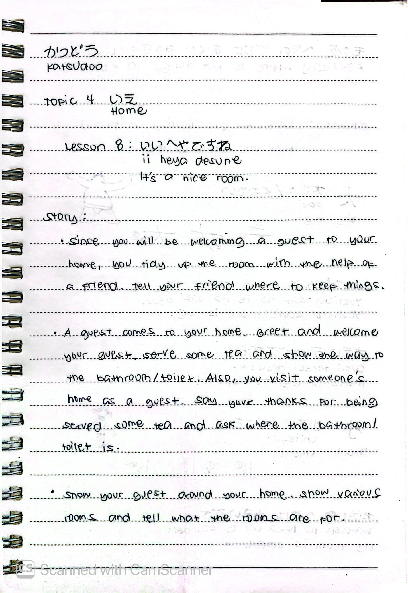
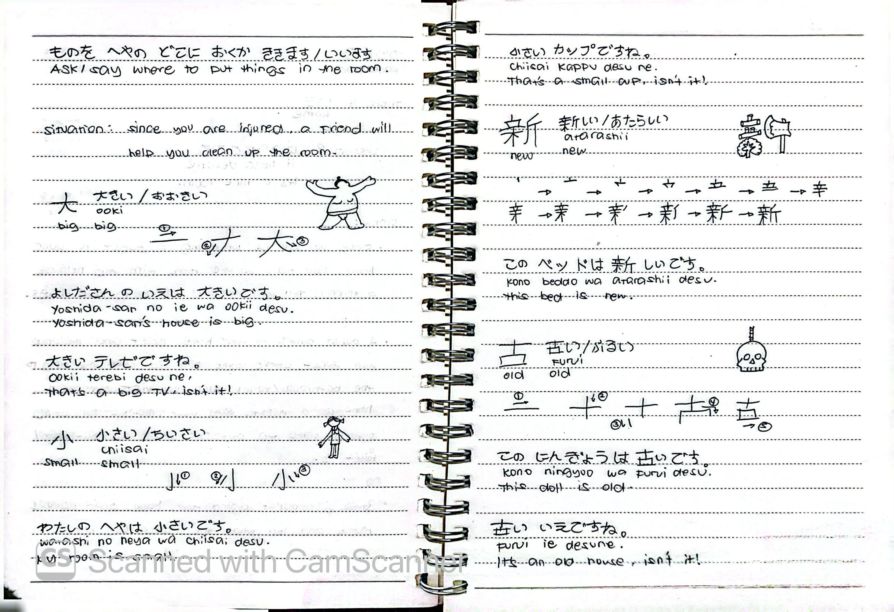

# 🎌 Lesson 8: いいへやですね (Ii heya desu ne)

**Course:** Marugoto A1-1 (Katsudoo & Rikai)
**Topic:** Topic 4 — いえ (Ie - Home)
**Mode:** かつどう (Katsudoo)
**Status:** 🚧 In Progress

---

## 🎯 Can-Do Objective
**Can-do 8:** Welcome a guest and show them around your home.
**Goal:** いえに ひとを しょうたいします (Invite someone to your house)

---

## 📖 Story: Welcoming a Guest

**Situation:**
1. Since you will be welcoming a guest to your home, you tidy up the room with the help of a friend. Tell your friend where to keep things.
2. A guest comes to your home. Greet and welcome your guest, serve some tea, and show the way to the bathroom/toilet. Also, you visit someone's home as a guest. Say your thanks for being served some tea and ask where the bathroom/toilet is.
3. Show your guest around your home. Show various rooms and tell what the rooms are for.

---

## ✍️ Kanji Practice

### 大 (ookii) — Big
**Stroke order:** 一 → 丿 → 乀 → 大
* よしださんの いえは 大きいです。 (*Yoshida-san no ie wa ookii desu.*) — Yoshida-san's house is big.
* 大きいテレビですね。 (*Ookii terebi desu ne.*) — That's a big TV, isn't it!

### 小 (chiisai) — Small
**Stroke order:** 亅 → 八 → 小
* わたしの へやは 小さいです。 (*Watashi no heya wa chiisai desu.*) — My room is small.
* 小さいカップですね。 (*Chiisai kappu desu ne.*) — That's a small cup, isn't it!

### 新 (atarashii) — New
**Stroke order:** 立 → 木 → 斤 → 新
* この ベッドは 新しいです。 (*Kono beddo wa atarashii desu.*) — This bed is new.

### 古 (furui) — Old
**Stroke order:** 十 → 口 → 古
* この にんぎょうは 古いです。 (*Kono ningyoo wa furui desu.*) — This doll is old.
* 古い いえですね。 (*Furui ie desu ne.*) — It's an old house, isn't it!

---

## 🗣️ Key Phrases

### Asking/Saying Where to Put Things
**Sentence:** ものを へやの どこに おくか ききます/いいます。
*Ask/say where to put things in the room.*

| Japanese | Romaji | English |
| :--- | :--- | :--- |
| これは どこに おきますか。 | *Kore wa doko ni okimasu ka.* | Where should I put this? |
| そこに おいて ください。 | *Soko ni oite kudasai.* | Please put it there. |

---

## 📝 Study Log & Additional Notes

- **2026-11-06:** Started Katsudoo Lesson 8. Learned kanji 大 (big), 小 (small), 新 (new), 古 (old), and how to ask/say where to put things in a room.

---

## 📸 Handwritten Notes (Appendix)
> *Scanned pages from my physical study notebook.*

**Page 1 — Story & Greeting a Guest**

**Page 2 — Kanji Practice & Phrases**
