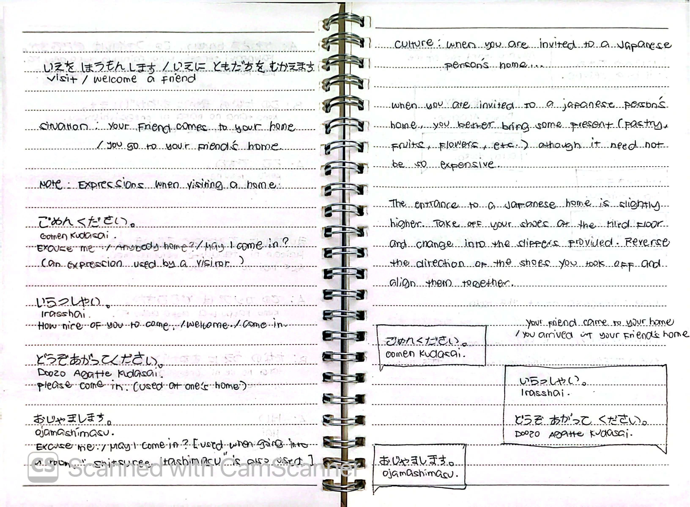
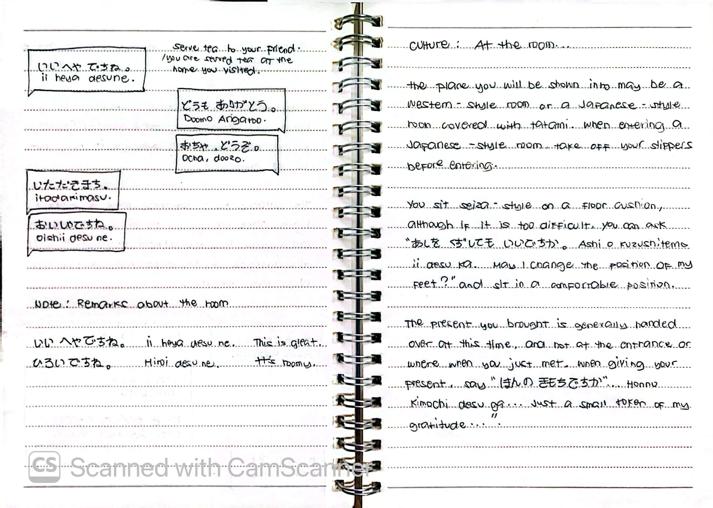

# 🎌 Lesson 8: いいへやですね (Ii heya desu ne)

**Course:** Marugoto A1-1 (Katsudoo & Rikai)
**Topic:** Topic 4 — いえ (Ie - Home)
**Mode:** かつどう (Katsudoo)
**Status:** 🚧 In Progress

---

## 🎯 Can-Do Objective
**Can-do 8:** Welcome a guest and show them around your home.
**Goal:** いえに ひとを しょうたいします (Invite someone to your house)

---

## 📖 Story: Welcoming a Guest

**Situation:**
1. Since you will be welcoming a guest to your home, you tidy up the room with the help of a friend. Tell your friend where to keep things.
2. A guest comes to your home. Greet and welcome your guest, serve some tea, and show the way to the bathroom/toilet. Also, you visit someone's home as a guest. Say your thanks for being served some tea and ask where the bathroom/toilet is.
3. Show your guest around your home. Show various rooms and tell what the rooms are for.

---

## ✍️ Kanji Practice

### 大 (ookii) — Big
**Stroke order:** 一 → 丿 → 乀 → 大
* よしださんの いえは 大きいです。 (*Yoshida-san no ie wa ookii desu.*) — Yoshida-san's house is big.

### 小 (chiisai) — Small
**Stroke order:** 亅 → 八 → 小
* わたしの へやは 小さいです。 (*Watashi no heya wa chiisai desu.*) — My room is small.

### 新 (atarashii) — New
**Stroke order:** 立 → 木 → 斤 → 新
* この ベッドは 新しいです。 (*Kono beddo wa atarashii desu.*) — This bed is new.

### 古 (furui) — Old
**Stroke order:** 十 → 口 → 古
* この にんぎょうは 古いです。 (*Kono ningyoo wa furui desu.*) — This doll is old.

---

## 📦 Vocabulary: Objects & Locations

### Objects
| Japanese | Romaji | English |
| :--- | :--- | :--- |
| ほん | *hon* | book |
| しゃしん | *shashin* | photo |
| テーブル | *teeburu* | table |
| カップ | *kappu* | cup |
| にんぎょう | *ningyoo* | doll |
| はこ | *hako* | box |
| とけい | *tokee* | clock |
| たな | *tana* | shelf / rack |
| ファイル | *fairu* | file |

### Location Words
**Structure:** `[Noun] の [Location]` (e.g., はこの うえ = on top of the box)

| Japanese | Romaji | English |
| :--- | :--- | :--- |
| うえ | *ue* | on top of / above |
| なか | *naka* | inside / in |
| した | *shita* | under / below |
| よこ | *yoko* | beside / next to |

---

## 🗣️ Key Phrases: Asking Where Things Are/Go

### Interrogative: どこ (doko - where)
*「どこですか」(doko desu ka) is used when asking for a location, or inquiring where to put a thing.*

| Japanese | Romaji | English |
| :--- | :--- | :--- |
| トイレは どこですか。 | *Toire wa doko desu ka.* | Where is the toilet? |
| にんぎょうは どこですか。 | *Ningyoo wa doko desu ka.* | Where do I put the doll? |

### Telling someone where to put something
**Structure:** `[Location] に おねがいします` (Please put it in/on [Location])

| Japanese | Romaji | English |
| :--- | :--- | :--- |
| はこの なかに おねがいします。 | *Hako no naka ni onegaishimasu.* | Inside the box, please. |
| たなの うえに おねがいします。 | *Tana no ue ni onegaishimasu.* | On the shelf, please. |

---

## 🚪 Visiting a Friend's Home (いえを ほうもんします)

### Expressions When Visiting
| Speaker | Japanese | Romaji | English |
| :--- | :--- | :--- | :--- |
| Visitor | ごめんください。 | *Gomen kudasai.* | Excuse me. / Anybody home? / May I come in? |
| Host | いらっしゃい。 | *Irasshai.* | How nice of you to come / Welcome / Come in. |
| Host | どうぞ あがって ください。 | *Doozo agatte kudasai.* | Please come in. |
| Visitor | おじゃまします。 | *Ojama shimasu.* | Excuse me. / May I come in? *(Used when going into a room. "Shitsuree shimasu" is also used.)* |

### Serving Tea & Remarks About the Room
| Speaker | Japanese | Romaji | English |
| :--- | :--- | :--- | :--- |
| Visitor | いい へやですね。 | *Ii heya desu ne.* | This is a great room. |
| Host | おちゃ、どうぞ。 | *Ocha, doozo.* | Tea, please. |
| Visitor | いただきます。 | *Itadakimasu.* | Thank you for the food/drink. |
| Visitor | おいしいですね。 | *Oishii desu ne.* | It's delicious. |
| — | ひろいですね。 | *Hiroi desu ne.* | It's roomy. |

---

## 🇯🇵 Culture Notes

### When You Are Invited to a Japanese Person's Home
*   **Bring a present:** You better bring some present (pastry, fruits, flowers, etc.), although it need not be so expensive.
*   **The Entrance:** The entrance to a Japanese home is slightly higher. Take off your shoes at the entrance and change into the slippers provided. 
*   **Shoe etiquette:** Reverse the direction of the shoes you took off and align them together.

### At the Room
*   **Room styles:** The room you are shown into may be a Western-style room or a Japanese-style room covered with tatami. When entering a Japanese-style room, take off your slippers before entering.
*   **Sitting:** You sit seiza-style on a floor cushion. If it is too difficult, you can ask: 
    *   **あしを くずして いいですか。** (*Ashi o kuzushite ii desu ka.*) — May I change the position of my feet?
    *   Then sit in a comfortable position.
*   **Giving the present:** The present you brought is generally handed over at this time (not at the entrance or when you just met). When giving your present, say:
    *   **ほんの きもちですが...** (*Honno kimochi desu ga...*) — Just a small token of my gratitude...

---

## 💬 Practice Dialogues

### Dialogue 1: Putting the Doll Away
| Speaker | Japanese | Romaji | English |
| :--- | :--- | :--- | :--- |
| A | にんぎょうは どこですか。 | *Ningyoo wa doko desu ka.* | Where do I put the doll? |
| B | はこの なかに おねがいします。 | *Hako no naka ni onegaishimasu.* | Inside the box, please. |
| A | はこの なかですね。 | *Hako no naka desu ne.* | Inside the box, right? |

### Dialogue 2: Kawasaki-sensei is putting things away
| Speaker | Japanese | Romaji | English |
| :--- | :--- | :--- | :--- |
| — | かわさきせんせいが かたづけを しています。 | *Kawasaki-sensei ga katadzuke o shite imasu.* | Mrs. Kawasaki is putting things away. |
| A | かわさきせんせい、このファイルは どこですか。 | *Kawasaki-sensei, kono fairu wa doko desu ka.* | Ms. Kawasaki, where should I put this file? |
| B | この たなの なかに おねがいします。 | *Kono tana no naka ni onegaishimasu.* | In these shelves please. |
| A | ここですね。 | *Koko desu ne.* | Ah, just here? |

### Dialogue 3: Asking Mai for help
| Speaker | Japanese | Romaji | English |
| :--- | :--- | :--- | :--- |
| — | まいさんに てつだって もらいましょう。 | *Mai-san ni tetsudatte moraimashoo.* | Ask Mai to help you. |
| A | この カップは どこですか。 | *Kono kappu wa doko desu ka.* | Where does this cup go? |
| B | たなの うえに おねがいします。 | *Tana no ue ni onegaishimasu.* | On the rack, please. |
| A | はい。 | *Hai.* | Okay. |

---

## 📝 Study Log & Additional Notes

- **2026-11-06:** Started Katsudoo Lesson 8. Learned kanji 大 (big), 小 (small), 新 (new), 古 (old), and how to ask/say where to put things in a room.
- **2026-11-07:** Continued Katsudoo Lesson 8. Learned vocabulary for household objects, location words (うえ, なか, した, よこ), and how to use どこですか and ～に おねがいします.
- **2026-11-09:** Learned polite expressions for visiting a home (ごめんください, おじゃまします) and cultural rules (bringing a present, removing shoes, sitting on tatami). Learned how to offer/accept tea and give presents.

---

## 📸 Handwritten Notes (Appendix)
> *Scanned pages from my physical study notebook.*

**Page 1 — Story & Greeting a Guest**

**Page 2 — Kanji Practice & Phrases**

**Page 3 — Vocab, Location Words, & どこ**

**Page 4 — Putting Things Away & Dialogues**

**Page 5 — Visiting a Home & Entrance Culture**

**Page 6 — Serving Tea & Tatami Room Culture**
