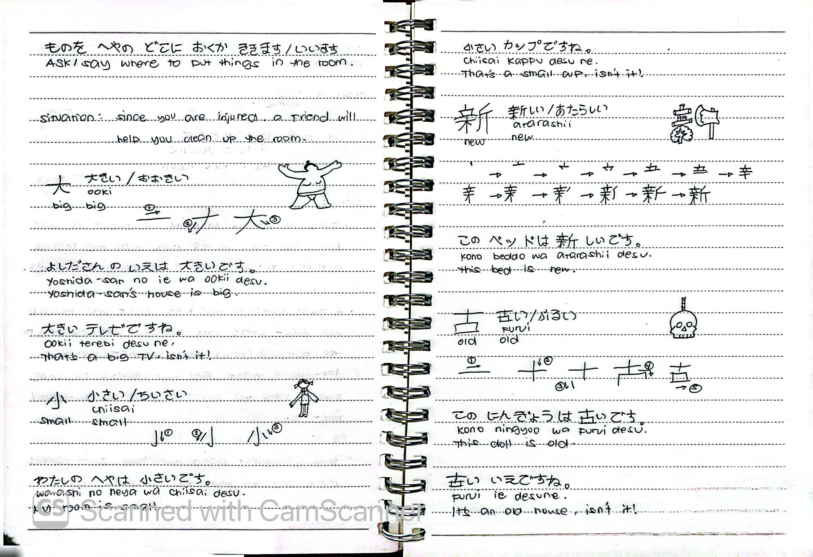
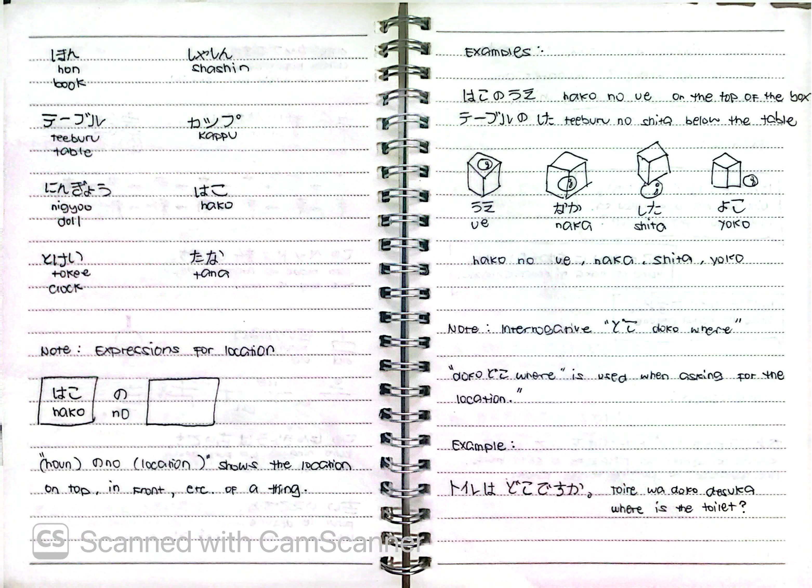
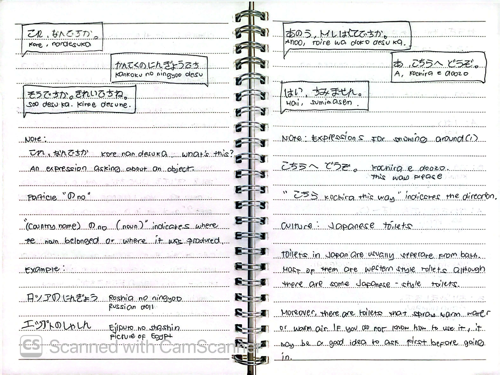
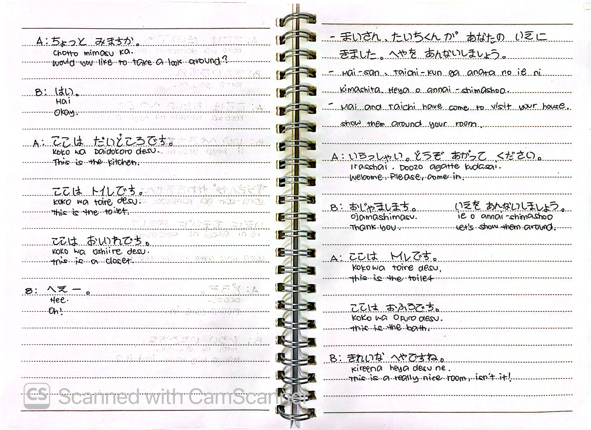

# 🎌 Lesson 8: いいへやですね (Ii heya desu ne)

**Course:** Marugoto A1-1 (Katsudoo & Rikai)
**Topic:** Topic 4 — いえ (Ie - Home)
**Mode:** かつどう (Katsudoo)
**Status:** 🚧 In Progress

---

## 🎯 Can-Do Objective
**Can-do 8:** Welcome a guest and show them around your home.
**Goal:** いえに ひとを しょうたいします (Invite someone to your house)

---

## 📖 Story: Welcoming a Guest

**Situation:**
1. Since you will be welcoming a guest to your home, you tidy up the room with the help of a friend. Tell your friend where to keep things.
2. A guest comes to your home. Greet and welcome your guest, serve some tea, and show the way to the bathroom/toilet. Also, you visit someone's home as a guest. Say your thanks for being served some tea and ask where the bathroom/toilet is.
3. Show your guest around your home. Show various rooms and tell what the rooms are for.

---

## ✍️ Kanji Practice

### 大 (ookii) — Big
**Stroke order:** 一 → 丿 → 乀 → 大
* よしださんの いえは 大きいです。 (*Yoshida-san no ie wa ookii desu.*) — Yoshida-san's house is big.

### 小 (chiisai) — Small
**Stroke order:** 亅 → 八 → 小
* わたしの へやは 小さいです。 (*Watashi no heya wa chiisai desu.*) — My room is small.

### 新 (atarashii) — New
**Stroke order:** 立 → 木 → 斤 → 新
* この ベッドは 新しいです。 (*Kono beddo wa atarashii desu.*) — This bed is new.

### 古 (furui) — Old
**Stroke order:** 十 → 口 → 古
* この にんぎょうは 古いです。 (*Kono ningyoo wa furui desu.*) — This doll is old.

---

## 📦 Vocabulary: Objects, Rooms & Locations

### Objects
| Japanese | Romaji | English |
| :--- | :--- | :--- |
| ほん | *hon* | book |
| しゃしん | *shashin* | photo |
| テーブル | *teeburu* | table |
| カップ | *kappu* | cup |
| にんぎょう | *ningyoo* | doll |
| はこ | *hako* | box |
| とけい | *tokee* | clock |
| たな | *tana* | shelf / rack |
| ファイル | *fairu* | file |
| スリッパ | *surippa* | slippers |

### Rooms & Areas
| Japanese | Romaji | English |
| :--- | :--- | :--- |
| だいどころ | *daidokoro* | kitchen |
| おふろ | *ofuro* | bath / bathroom |
| へや | *heya* | room |
| トイレ | *toire* | toilet |
| にわ | *niwa* | garden |
| げんかん | *genkan* | entrance |
| おしいれ | *oshiire* | closet |

### Location Words
**Structure:** `[Noun] の [Location]` (e.g., はこの うえ = on top of the box)

| Japanese | Romaji | English |
| :--- | :--- | :--- |
| うえ | *ue* | on top of / above |
| なか | *naka* | inside / in |
| した | *shita* | under / below |
| よこ | *yoko* | beside / next to |

---

## 🗣️ Key Phrases & Grammar

### Asking "What is this?"
| Japanese | Romaji | English |
| :--- | :--- | :--- |
| これは なんですか。 | *Kore wa nan desu ka.* | What is this? |
| かんこくの にんぎょうです。 | *Kankoku no ningyoo desu.* | It's a Korean doll. |
| そうですか。きれいですね。 | *Soo desu ka. Kiree desu ne.* | I see. It's beautiful, isn't it. |

### Particle の (Origin/Production)
`(Country name) の (Noun)` indicates where the noun belonged or where it was produced.
* ロシアの にんぎょう (*Roshia no ningyoo*) — Russian doll
* エジプトの しゃしん (*Ejiputo no shashin*) — Picture of Egypt

### Showing Around the House
| Japanese | Romaji | English |
| :--- | :--- | :--- |
| ここは トイレです。 | *Koko wa toire desu.* | Here is the toilet. |
| ここは だいどころです。 | *Koko wa daidokoro desu.* | This is the kitchen. |
| ちょっと みますか。 | *Chotto mimasu ka.* | Would you like to take a look around? |
| いえの なかを あんないします。 | *Ie no naka o annai shimasu.* | Show someone around your home. |

> **Note:** 「ここ (koko - here)」indicates the location.

---

## 🚪 Visiting a Friend's Home

### Dialogue 1: Sara visits Kawasaki-sensei
| Speaker | Japanese | Romaji | English |
| :--- | :--- | :--- | :--- |
| — | サラさんが かわさきせんせいの いえに あそびに きました。 | *Sara-san ga Kawasaki-sensee no ie ni asobi ni kimashita.* | Sara has come to see Ms. Kawasaki at her house. |
| A (Kawasaki) | はい。 | *Hai.* | Yes? |
| B (Sara) | こんにちは。サラです。 | *Konnichiwa. Sara desu.* | Hello, it's Sara. |
| A (Kawasaki) | ああ、はーい。いらっしゃい。どうぞ あがって ください。 | *Aa, haai. Irasshai. Doozo agatte kudasai.* | Ah, hello! Welcome. Please come in. |
| B (Sara) | おじゃまします。 | *Ojama shimasu.* | Thank you (for having me). |
| A (Kawasaki) | この スリッパ、どうぞ。 | *Kono surippa, doozo.* | Here, use these slippers. |
| B (Sara) | ありがとうございます。 | *Arigatoo gozaimasu.* | Thank you very much. |
| A (Kawasaki) | どうぞ。 | *Doozo.* | Please come through. |
| B (Sara) | わあ、ひろい いえですね。 | *Waa, hiroi ie desu ne.* | Wow, it's a big house, isn't it! |
| A (Kawasaki) | ちょっと みますか。 | *Chotto mimasu ka.* | Would you like to take a look around? |
| B (Sara) | はい。 | *Hai.* | Okay. |
| A (Kawasaki) | ここは だいどころです。 | *Koko wa daidokoro desu.* | This is the kitchen. |
|   | ここは トイレです。 | *Koko wa toire desu.* | This is the toilet. |
|   | ここは おしいれです。 | *Koko wa oshiire desu.* | This is a closet. |
| B (Sara) | へえー。 | *Hee.* | Oh! |

### Dialogue 2: Touring the House with Mai & Taichi
| Speaker | Japanese | Romaji | English |
| :--- | :--- | :--- | :--- |
| — | まいさん、たいちくんが あなたの いえに きました。へやを あんないしましょう。 | *Mai-san, Taichi-kun ga anata no ie ni kimashita. Heya o annai shimashoo.* | Mai and Taichi have come to visit your house. Let's show them around. |
| A | いらっしゃい。どうぞ あがって ください。 | *Irasshai. Doozo agatte kudasai.* | Welcome. Please come in. |
| B | おじゃまします。 | *Ojama shimasu.* | Thank you (for having me). |
| A | いえを あんないしましょう。ここは トイレです。ここは おふろです。 | *Ie o annai shimashoo. Koko wa toire desu. Koko wa ofuro desu.* | Let's show them around. This is the toilet. This is the bath. |
| B | きれいな へやですね。 | *Kireena heya desu ne.* | This is a really nice room, isn't it! |

---

## 🇯🇵 Culture Notes

### When You Are Invited to a Japanese Person's Home
*   **Bring a present:** You better bring some present (pastry, fruits, flowers, etc.), although it need not be so expensive.
*   **The Entrance:** The entrance to a Japanese home is slightly higher. Take off your shoes at the entrance and change into the slippers provided. 
*   **Shoe etiquette:** Reverse the direction of the shoes you took off and align them together.

### At the Room
*   **Room styles:** The room you are shown into may be a Western-style room or a Japanese-style room covered with tatami. When entering a Japanese-style room, take off your slippers before entering.
*   **Sitting:** You sit seiza-style on a floor cushion. If it is too difficult, you can ask: 
    *   **あしを くずして いいですか。** (*Ashi o kuzushite ii desu ka.*) — May I change the position of my feet?
*   **Giving the present:** The present you brought is generally handed over at this time. When giving it, say:
    *   **ほんの きもちですが...** (*Honno kimochi desu ga...*) — Just a small token of my gratitude...

### Japanese Toilets
*   Toilets in Japan are usually separate from the bath.
*   Most of them are Western-style toilets, although there are some Japanese-style toilets.
*   Moreover, there are toilets that spray warm water or warm air. If you do not know how to use it, it may be a good idea to ask first before going in.

---

## 📝 Study Log & Additional Notes

- **2026-11-06:** Started Katsudoo Lesson 8. Learned kanji 大 (big), 小 (small), 新 (new), 古 (old), and how to ask/say where to put things in a room.
- **2026-11-07:** Continued Katsudoo Lesson 8. Learned vocabulary for household objects, location words, and how to use どこですか and ～に おねがいします.
- **2026-11-09:** Learned polite expressions for visiting a home (ごめんください, おじゃまします) and cultural rules (bringing a present, removing shoes).
- **2026-11-14:** Learned how to ask "What is this?" (これは なんですか), the particle の for origin, and cultural notes about Japanese toilets.
- **2026-11-16:** Learned how to show someone around the house (ここは ～です, あんないします), and practiced full house tour dialogues.

---

## 📸 Handwritten Notes (Appendix)
> *Scanned pages from my physical study notebook.*

**Page 1 — Story & Greeting a Guest**

**Page 2 — Kanji Practice & Phrases**

**Page 3 — Vocab, Location Words, & どこ**

**Page 4 — Putting Things Away & Dialogues**

**Page 5 — Visiting a Home & Entrance Culture**

**Page 6 — Serving Tea & Tatami Room Culture**

**Page 7 — What is this? & Particle の**

**Page 8 — Visiting Dialogues & Toilet Culture**

**Page 9 — Showing Around Vocab & Sara Dialogue**

**Page 10 — House Tour Dialogues**
