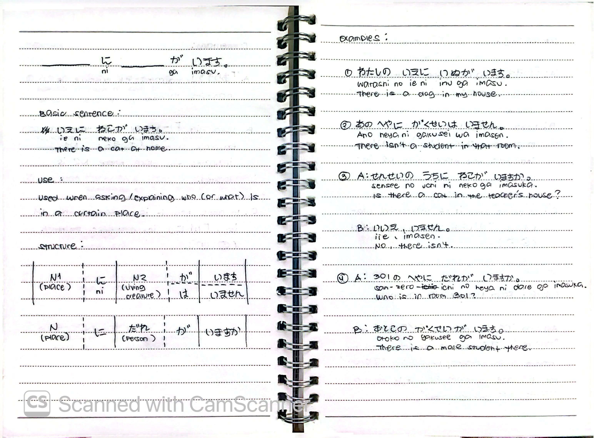
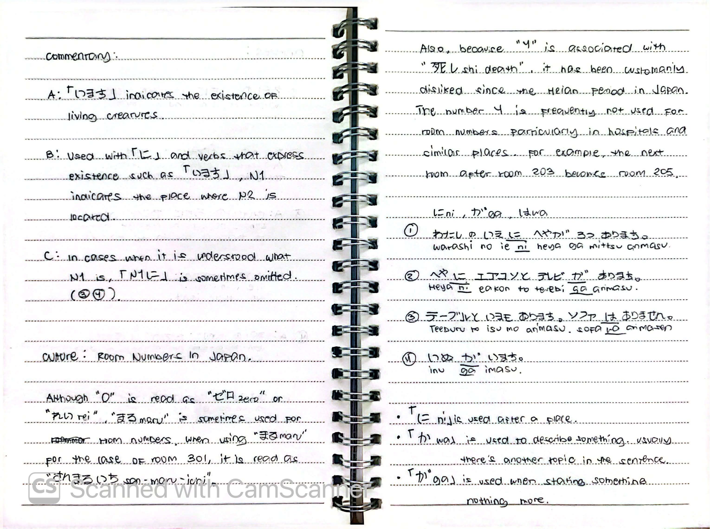

# 🎌 Rikai Lesson 7: へやが 3つ あります (Heya ga mittsu arimasu)

**Course:** Marugoto A1-1 (Katsudoo & Rikai)
**Topic:** Topic 4 — いえ (Ie - Home)
**Mode:** りかい (Rikai)
**Status:** 🚧 In Progress

---

## 🎯 Can-Do Objective
**Can-do:** Describe your home and what is in it using existence verbs.
**Goal:** いえに なにが あるか いいます (Say what is in your house)

---

## 🗣️ Basic Sentences

| Japanese | Romaji | English |
| :--- | :--- | :--- |
| とうきょうに すんで います。 | *Tookyoo ni sunde imasu.* | I live in Tokyo. |
| いっこだてに すんで います。 | *Ikkodate ni sunde imasu.* | I live in a detached house. |
| かぞく と すんで います。 | *Kazoku to sunde imasu.* | I live with my family. |
| アパートに すんで います。 | *Apaato ni sunde imasu.* | I live in an apartment. |

---

## 🏠 Vocabulary

### Furniture & Home Objects
| Japanese | Romaji | English |
| :--- | :--- | :--- |
| いす | *isu* | chair |
| テーブル | *teeburu* | table |
| ベッド | *beddo* | bed |
| ソファ | *sofa* | sofa |
| かぐ | *kagu* | furniture |
| ほんだな | *hondana* | bookshelf |
| つくえ | *tsukue* | desk |
| かざり | *kazari* | ornament |
| たな | *tana* | shelf |

### Electrical Appliances (でんきせいひん)
| Japanese | Romaji | English |
| :--- | :--- | :--- |
| エアコン | *eakon* | air conditioner |
| テレビ | *terebi* | television |
| でんわ | *denwa* | telephone |
| れいぞうこ | *reizouko* | refrigerator |
| でんしレンジ | *denshi renji* | microwave oven |
| そうじき | *soujiki* | vacuum cleaner |
| せんたくき | *sentakuki* | washing machine |
| せんぷうき | *senpuuki* | electric fan |
| ストーブ | *sutoobu* | heater |
| ラジオ | *rajio* | radio |

### The Neighborhood (いえの ちかく)
| Japanese | Romaji | English |
| :--- | :--- | :--- |
| ちかく / ちかく | *chikaku* | nearby |
| こうえん | *kooen* | park |
| デパート | *depaato* | department store |
| レストラン | *resutoran* | restaurant |

---

## ⚖️ Opposite Meanings (Adjectives)

| Positive | Negative / Opposite |
| :--- | :--- |
| おおきいです (*ookii desu*) - big | ちいさいです (*chiisai desu*) - small |
| あたらしいです (*atarashii desu*) - new | ふるいです (*furui desu*) - old |
| あかるいです (*akarui desu*) - bright | くらいです (*kurai desu*) - dark |
| ひろいです (*hiroi desu*) - spacious | せまいです (*semai desu*) - narrow |

---

## 🔑 Grammar: Existence (あります vs います)

### Use
Used when asking or explaining the location of things.
* **あります (arimasu)** is used for **inanimate things** (objects, plants, etc.).
* **います (imasu)** is used for **animate things / living creatures** (people, animals).

### Structure

**For Inanimate Things (あります)**
N1 (Place) に N2 (inanimate) が あります。
N1 (Place) に なに が ありますか。

**For Living Creatures (います)**
N1 (Place) に N2 (living) が います。
N1 (Place) に だれ が いますか。

### Examples (います)

| # | Japanese | Romaji | English |
| :---: | :--- | :--- | :--- |
| ① | わたしの いえに いぬが います。 | *Watashi no ie ni inu ga imasu.* | There is a dog in my house. |
| ② | あの へやに がくせいは いません。 | *Ano heya ni gakusee wa imasen.* | There isn't a student in that room. |
| ③ | A: せんせいの うちに ねこが いますか。 | *A: Sensee no uchi ni neko ga imasu ka.* | A: Is there a cat in the teacher's house? |
|   | B: いいえ、いません。 | *B: Iie, imasen.* | B: No, there isn't. |
| ④ | A: 301の へやに だれが いますか。 | *A: San-zero-ichi no heya ni dare ga imasu ka.* | A: Who is in room 301? |
|   | B: おとこの がくせいが います。 | *B: Otoko no gakusee ga imasu.* | B: There is a male student there. |

### Commentary
**A.** 「います」indicates the existence of **living creatures**.
**B.** Used with 「に」and verbs that express existence such as 「います」, N1 indicates the **place** where N2 is located.
**C.** In cases when it is understood what N1 is, 「N1 に」is sometimes **omitted**. (See examples ③, ④).

---

## 🏢 Culture: Room Numbers in Japan

Although "0" is read as 「ゼロ」(*zero*) or 「れい」(*rei*), 「まる」(*maru*) is sometimes used for room numbers. 
* When using 「まる」 for the case of room 301, it is read as 「さんまるいち」(*san maru ichi*).

**The Number 4:**
Because "4" (し - *shi*) is associated with 「死」(*shi* - death), it has been customarily disliked since the Heian period in Japan. The number 4 is frequently not used for room numbers, particularly in hospitals and similar places.
* For example, the next room after room 203 becomes room 205 (skipping 204).

---

## 🔍 Particle Rules (に, が, は)

Based on the practice sentences:
1. わたしの いえ**に** へや**が** みっつ あります。 (*Watashi no ie ni heya ga mittsu arimasu.*)
2. へや**に** エアコンと テレビ**が** あります。 (*Heya ni eakon to terebi ga arimasu.*)
3. テーブルと いす**は** あります。ソファ**は** ありません。 (*Teeburu to isu wa arimasu. Sofa wa arimasen.*)
4. いぬ**が** います。 (*Inu ga imasu.*)

### Rules:
* **「に」(ni)** is used after a **place**.
* **「は」(wa)** is used to describe something **vaguely** (there's another topic in the sentence, often used for contrast).
* **「が」(ga)** is used when **stating something, nothing more** (neutral description).

---

## 📝 Study Log & Additional Notes

- **2026-10-29:** Started Rikai Lesson 7. Learned furniture and appliance vocabulary, opposite adjectives, how to use あります for inanimate objects, and います for living creatures.
- **2026-10-29:** Continued Rikai Lesson 7. Learned the culture behind Japanese room numbers (avoiding 4) and the nuances between particles に, が, and は in existence sentences.

---

## 📸 Handwritten Notes (Appendix)
> *Scanned pages from my physical study notebook.*

**Page 1 — Basic Sentences & Furniture Vocabulary**

**Page 2 — Appliances, Neighborhood, & Opposites**

**Page 3 — Sentences & あります Grammar**

**Page 4 — Grammar Examples & Commentary**

**Page 5 — います Grammar & Examples**

**Page 6 — Culture Note & Particle Rules**
