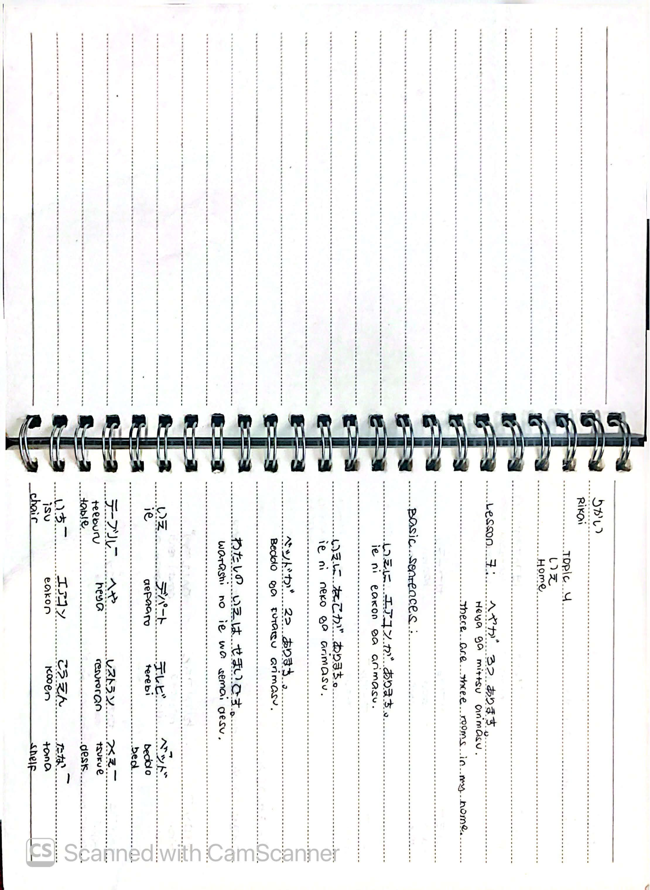
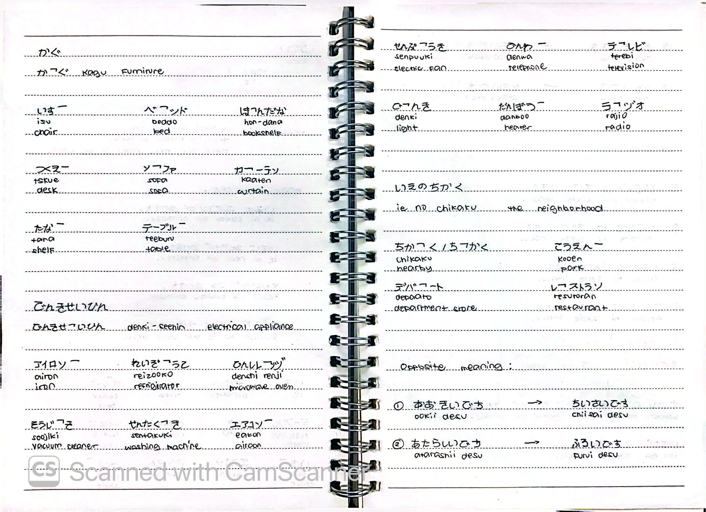
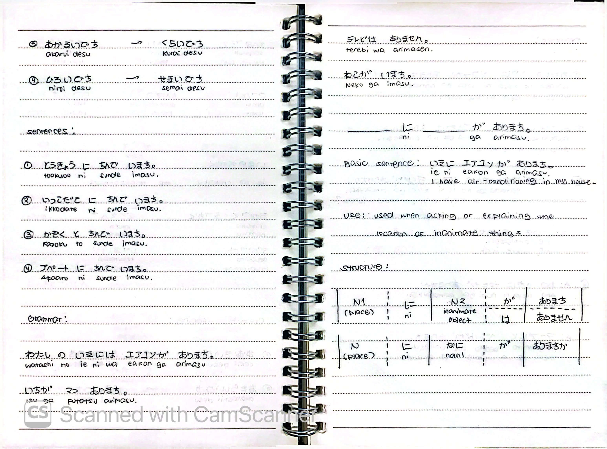
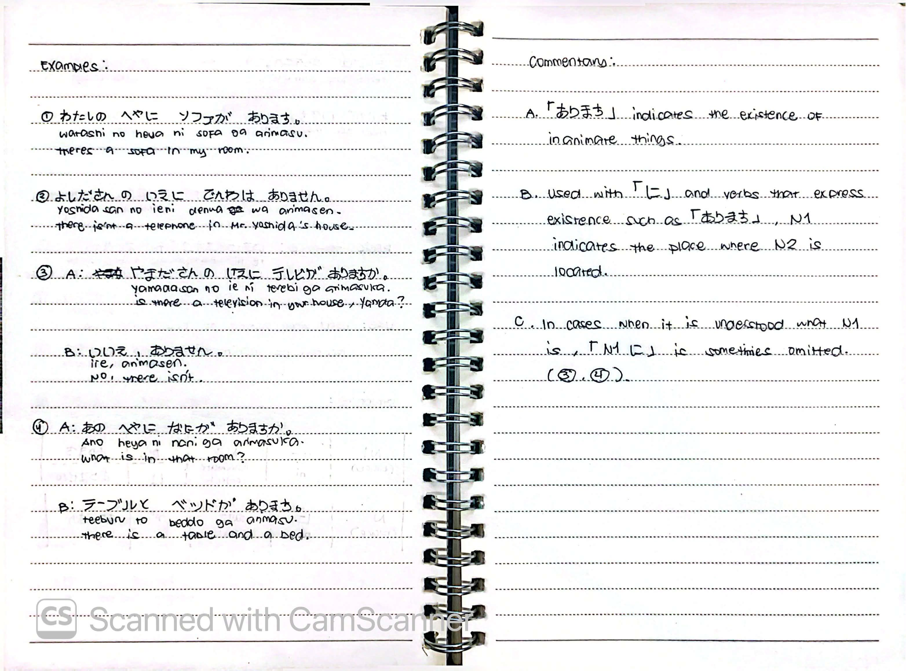
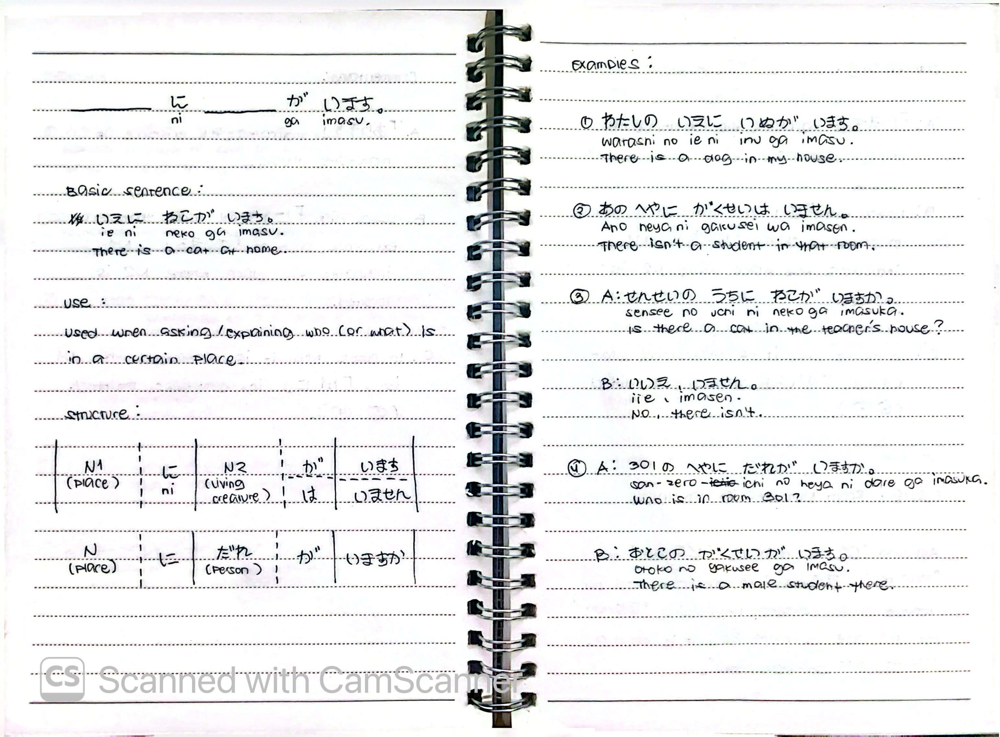
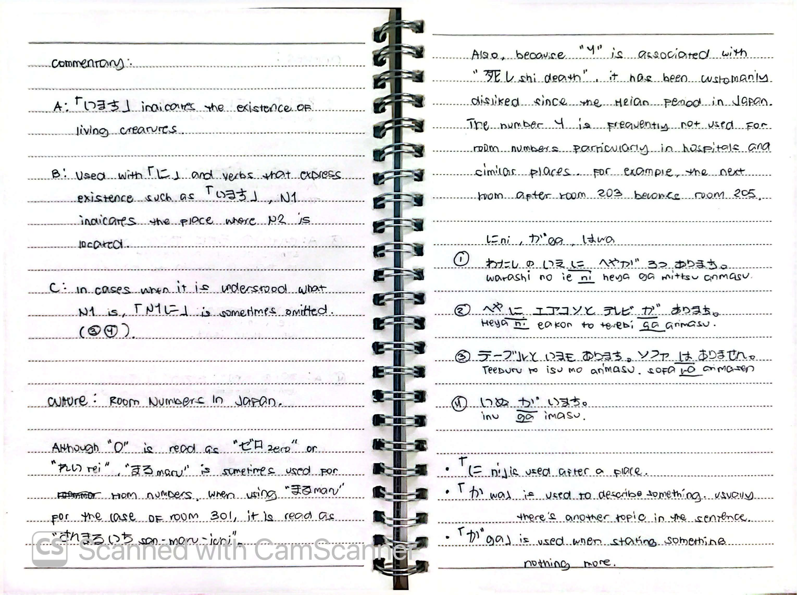
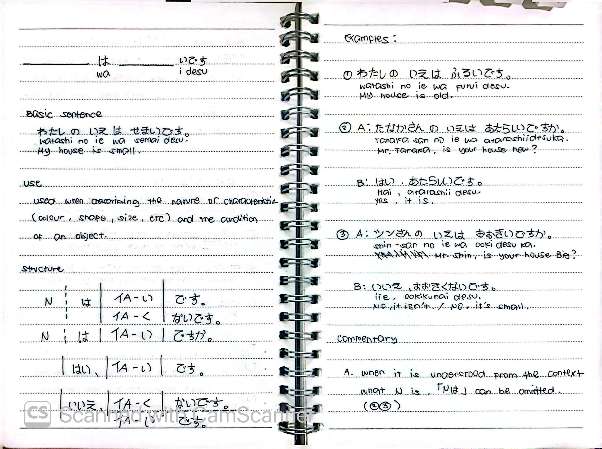
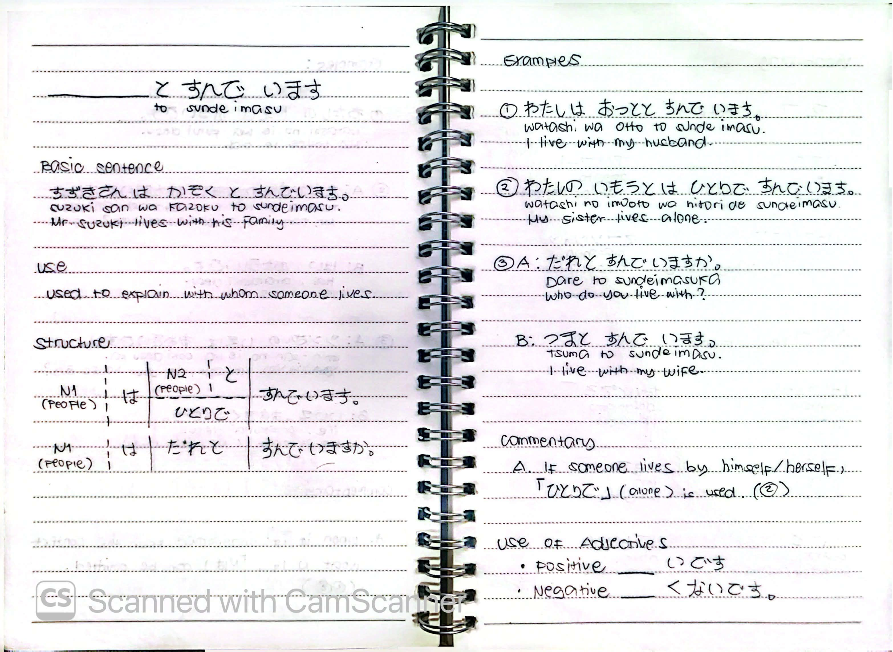
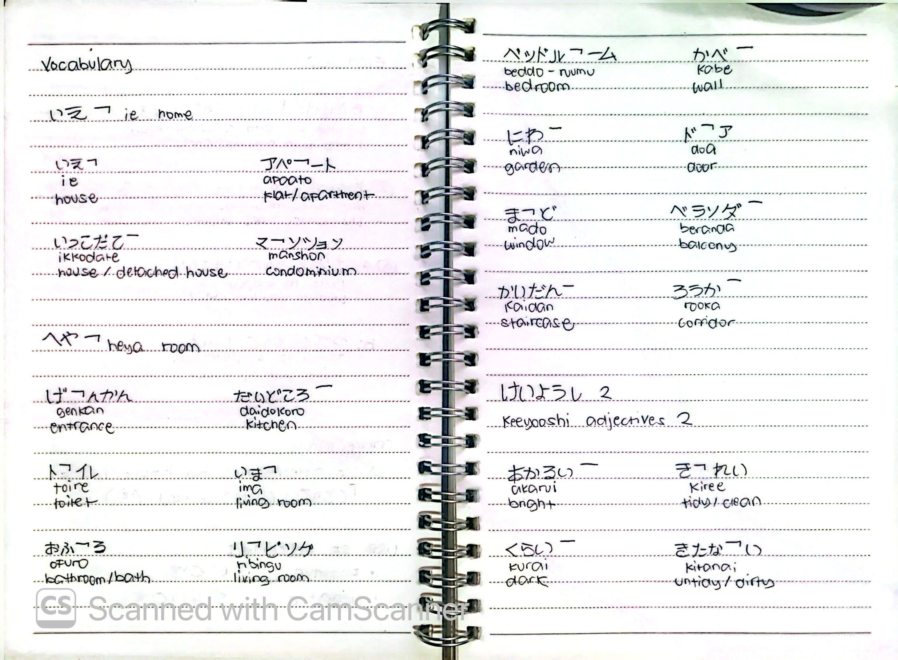
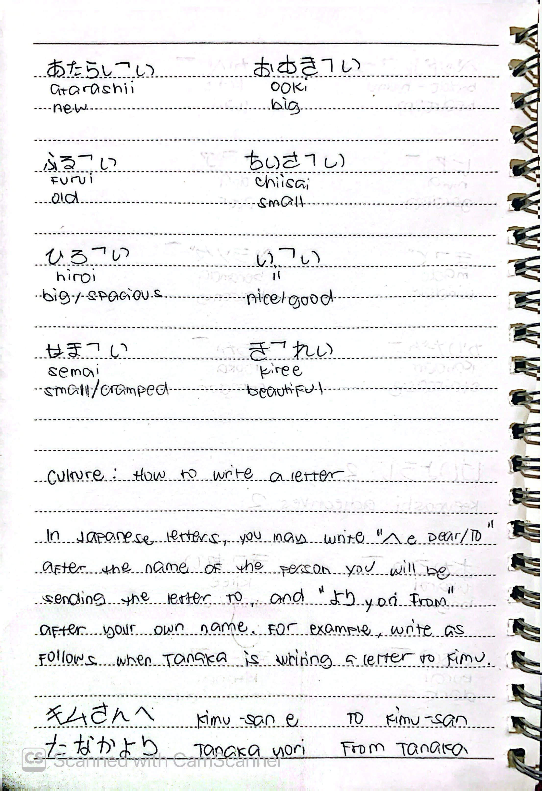

# 🎌 Rikai Lesson 7: へやが 3つ あります (Heya ga mittsu arimasu)

**Course:** Marugoto A1-1 (Katsudoo & Rikai)
**Topic:** Topic 4 — いえ (Ie - Home)
**Mode:** りかい (Rikai)
**Status:** ✅ Completed

---

## 🎯 Can-Do Objective
**Can-do:** Describe your home and what is in it using existence verbs and adjectives.
**Goal:** いえに なにが あるか いいます (Say what is in your house)

---

## 🗣️ Basic Sentences

| Japanese | Romaji | English |
| :--- | :--- | :--- |
| とうきょうに すんで います。 | *Tookyoo ni sunde imasu.* | I live in Tokyo. |
| いっこだてに すんで います。 | *Ikkodate ni sunde imasu.* | I live in a detached house. |
| かぞく と すんで います。 | *Kazoku to sunde imasu.* | I live with my family. |
| アパートに すんで います。 | *Apaato ni sunde imasu.* | I live in an apartment. |

---

## 🏠 Vocabulary: Home & Rooms

### Types of Homes
| Japanese | Romaji | English |
| :--- | :--- | :--- |
| いえ | *ie* | house / home |
| いっこだて | *ikkodate* | detached house |
| アパート | *apaato* | flat / apartment |
| マンション | *manshon* | condominium |

### Rooms & Areas
| Japanese | Romaji | English |
| :--- | :--- | :--- |
| へや | *heya* | room |
| げんかん | *genkan* | entrance |
| トイレ | *toire* | toilet |
| おふろ | *ofuro* | bathroom / bath |
| だいどころ | *daidokoro* | kitchen |
| いま | *ima* | living room |
| リビング | *ribingu* | living room |
| ベッドルーム | *beddo-rumu* | bedroom |

### Parts of a House
| Japanese | Romaji | English |
| :--- | :--- | :--- |
| かべ | *kabe* | wall |
| にわ | *niwa* | garden |
| ドア | *doa* | door |
| まど | *mado* | window |
| ベランダ | *beranda* | balcony |
| かいだん | *kaidan* | staircase |
| ろうか | *rouka* | corridor |

### Furniture & Home Objects
| Japanese | Romaji | English |
| :--- | :--- | :--- |
| いす | *isu* | chair |
| テーブル | *teeburu* | table |
| ベッド | *beddo* | bed |
| ソファ | *sofa* | sofa |
| かぐ | *kagu* | furniture |
| ほんだな | *hondana* | bookshelf |
| つくえ | *tsukue* | desk |
| かざり | *kazari* | ornament |
| たな | *tana* | shelf |

### Electrical Appliances (でんきせいひん)
| Japanese | Romaji | English |
| :--- | :--- | :--- |
| エアコン | *eakon* | air conditioner |
| テレビ | *terebi* | television |
| でんわ | *denwa* | telephone |
| れいぞうこ | *reizouko* | refrigerator |
| でんしレンジ | *denshi renji* | microwave oven |
| そうじき | *soujiki* | vacuum cleaner |
| せんたくき | *sentakuki* | washing machine |
| せんぷうき | *senpuuki* | electric fan |
| ストーブ | *sutoobu* | heater |
| ラジオ | *rajio* | radio |

---

## ⚖️ Adjectives (けいようし)

| Positive | Negative / Opposite |
| :--- | :--- |
| おおきいです (*ookii desu*) - big | ちいさいです (*chiisai desu*) - small |
| あたらしいです (*atarashii desu*) - new | ふるいです (*furui desu*) - old |
| ひろいです (*hiroi desu*) - spacious | せまいです (*semai desu*) - narrow |
| あかるいです (*akarui desu*) - bright | くらいです (*kurai desu*) - dark |
| きれいです (*kiree desu*) - beautiful/clean | きたないです (*kitanai desu*) - untidy / dirty |
| いいです (*ii desu*) - nice / good | わるいです (*warui desu*) - bad |

---

## 🔑 Grammar: Living With Someone (～と すんで います)

### Use
Used to explain **with whom someone lives**.

### Structure
N1 (person) は N2 (person) と すんで います。
N1 (person) は だれ と すんで いますか。

### Examples

| # | Japanese | Romaji | English |
| :---: | :--- | :--- | :--- |
| ① | わたしは おっと と すんで います。 | *Watashi wa otto to sunde imasu.* | I live with my husband. |
| ② | わたしの いもうとは ひとりで すんで います。 | *Watashi no imooto wa hitori de sunde imasu.* | My sister lives alone. |
| ③ | A: だれと すんで いますか。 | *A: Dare to sunde imasu ka.* | A: Who do you live with? |
|   | B: つま と すんで います。 | *B: Tsuma to sunde imasu.* | B: I live with my wife. |

### Commentary
If someone lives by himself/herself, 「ひとりで」(*hitori de* - alone) is used.

---

## 🔑 Grammar: い-Adjective Conjugation

### Use
Used when describing the nature or characteristic of an object.

### Structure
N は イA-い です。 (Affirmative)
N は イA-く ない です。 (Negative)
N は イA-い ですか。 (Interrogative)

---

## 🔑 Grammar: Existence (あります vs います)

### Structure

**For Inanimate Things (あります)**
N1 (Place) に N2 (inanimate) が あります。
N1 (Place) に なに が ありますか。

**For Living Creatures (います)**
N1 (Place) に N2 (living) が います。
N1 (Place) に だれ が いますか。

---

## 🏢 Culture: Room Numbers & Letters in Japan

### Room Numbers
Although "0" is read as 「ゼロ」(*zero*) or 「れい」(*rei*), 「まる」(*maru*) is sometimes used for room numbers. 
* Room 301 is read as 「さんまるいち」(*san maru ichi*).

Because "4" (し - *shi*) is associated with 「死」(*shi* - death), it has been customarily disliked since the Heian period. The number 4 is frequently skipped for room numbers.

### How to Write a Letter (Culture)
In Japanese letters, you may write "へ (e - dear/to)" after the name of the person you will be sending the letter to, and "より (yori - from)" after your own name. 

**Example (Tanaka writing to Kimu):**
* キムさんへ (*Kimu-san e*) — To Kimu-san
* たなかより (*Tanaka yori*) — From Tanaka

---

## 📝 Study Log & Additional Notes

- **2026-10-29:** Started Rikai Lesson 7. Learned furniture and appliance vocabulary, opposite adjectives, and how to use あります for inanimate objects and います for living creatures.
- **2026-10-31:** Continued Rikai Lesson 7. Learned how to conjugate い-adjectives to describe houses.
- **2026-11-04:** Learned how to say who you live with (～と すんで います), and expanded vocabulary for rooms, parts of a house, and adjectives.
- **2026-11-06:** Completed Rikai Lesson 7. Learned how to write Japanese letters (へ / より).

---

## 📸 Handwritten Notes (Appendix)
> *Scanned pages from my physical study notebook.*

**Page 1 — Basic Sentences & Furniture Vocabulary**

**Page 2 — Appliances, Neighborhood, & Opposites**

**Page 3 — Sentences & あります Grammar**

**Page 4 — Grammar Examples & Commentary**

**Page 5 — います Grammar & Examples**

**Page 6 — Culture Note & Particle Rules**

**Page 7 — い-Adjective Conjugation**

**Page 8 — Living with Someone Grammar**

**Page 9 — Rooms, House Parts, & Adjectives**

**Page 10 — Adjectives & Letter Writing Culture**
