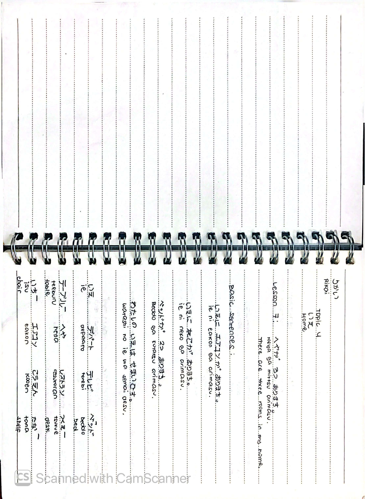
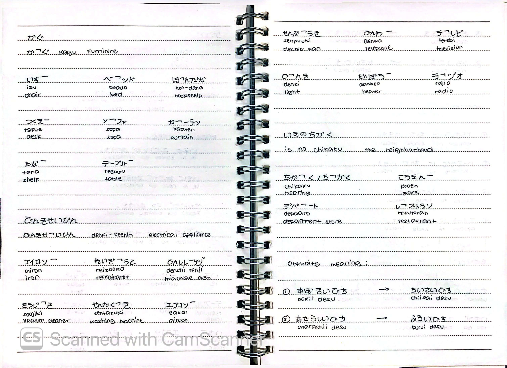
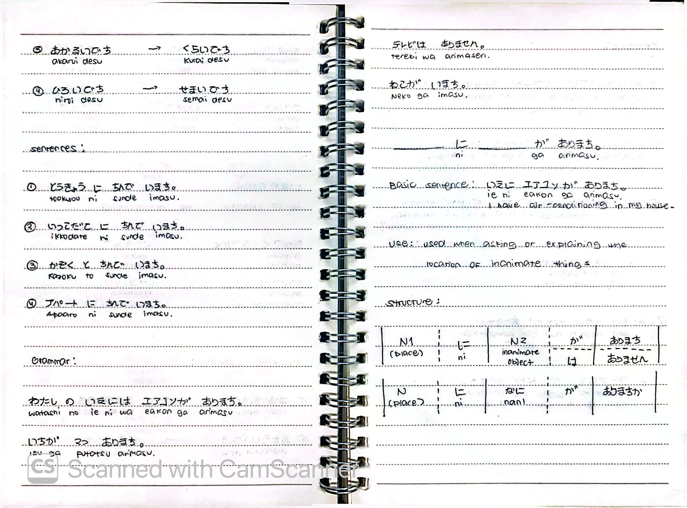
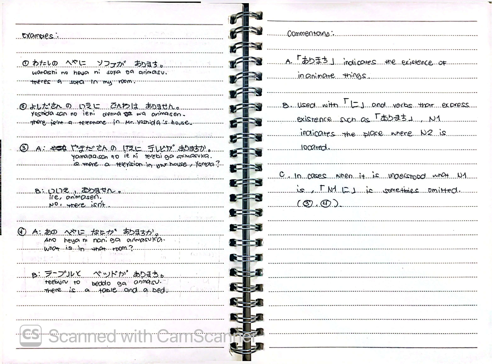

# 🎌 Rikai Lesson 7: へやが 3つ あります (Heya ga mittsu arimasu)

**Course:** Marugoto A1-1 (Katsudoo & Rikai)
**Topic:** Topic 4 — いえ (Ie - Home)
**Mode:** りかい (Rikai)
**Status:** 🚧 In Progress

---

## 🎯 Can-Do Objective
**Can-do:** Describe your home and what is in it using existence verbs.
**Goal:** いえに なにが あるか いいます (Say what is in your house)

---

## 🗣️ Basic Sentences

| Japanese | Romaji | English |
| :--- | :--- | :--- |
| とうきょうに すんで います。 | *Tookyoo ni sunde imasu.* | I live in Tokyo. |
| いっこだてに すんで います。 | *Ikkodate ni sunde imasu.* | I live in a detached house. |
| かぞく と すんで います。 | *Kazoku to sunde imasu.* | I live with my family. |
| アパートに すんで います。 | *Apaato ni sunde imasu.* | I live in an apartment. |

---

## 🏠 Vocabulary

### Furniture & Home Objects
| Japanese | Romaji | English |
| :--- | :--- | :--- |
| いす | *isu* | chair |
| テーブル | *teeburu* | table |
| ベッド | *beddo* | bed |
| ソファ | *sofa* | sofa |
| かぐ | *kagu* | furniture |
| ほんだな | *hondana* | bookshelf |
| つくえ | *tsukue* | desk |
| かざり | *kazari* | ornament |
| たな | *tana* | shelf |

### Electrical Appliances (でんきせいひん)
| Japanese | Romaji | English |
| :--- | :--- | :--- |
| エアコン | *eakon* | air conditioner |
| テレビ | *terebi* | television |
| でんわ | *denwa* | telephone |
| れいぞうこ | *reizouko* | refrigerator |
| でんしレンジ | *denshi renji* | microwave oven |
| そうじき | *soujiki* | vacuum cleaner |
| せんたくき | *sentakuki* | washing machine |
| せんぷうき | *senpuuki* | electric fan |
| ストーブ | *sutoobu* | heater |
| ラジオ | *rajio* | radio |

### The Neighborhood (いえの ちかく)
| Japanese | Romaji | English |
| :--- | :--- | :--- |
| ちかく / ちかく | *chikaku* | nearby |
| こうえん | *kooen* | park |
| デパート | *depaato* | department store |
| レストラン | *resutoran* | restaurant |

---

## ⚖️ Opposite Meanings (Adjectives)

| Positive | Negative / Opposite |
| :--- | :--- |
| おおきいです (*ookii desu*) - big | ちいさいです (*chiisai desu*) - small |
| あたらしいです (*atarashii desu*) - new | ふるいです (*furui desu*) - old |
| あかるいです (*akarui desu*) - bright | くらいです (*kurai desu*) - dark |
| ひろいです (*hiroi desu*) - spacious | せまいです (*semai desu*) - narrow |

---

## 🔑 Grammar: Existence (あります / います)

### Use
Used when asking or explaining the location of things.
* **あります (arimasu)** is used for **inanimate things** (objects, plants, etc.).
* **います (imasu)** is used for **animate things** (people, animals).

### Structure
N1 (Place) に N2 (inanimate) が あります。
N1 (Place) に N2 (animate) が います。
N1 (Place) に なに が ありますか。

### Examples

| # | Japanese | Romaji | English |
| :---: | :--- | :--- | :--- |
| ① | わたしの へやに ソファが あります。 | *Watashi no heya ni sofa ga arimasu.* | There's a sofa in my room. |
| ② | よしださんの いえに でんわは ありません。 | *Yoshida-san no ie ni denwa wa arimasen.* | There isn't a telephone in Mr. Yoshida's house. |
| ③ | A: やまださんの いえに テレビが ありますか。 | *A: Yamada-san no ie ni terebi ga arimasu ka.* | A: Is there a television in your house, Yamada? |
|   | B: いいえ、ありません。 | *B: Iie, arimasen.* | B: No, there isn't. |
| ④ | A: あの へやに なにが ありますか。 | *A: Ano heya ni nani ga arimasu ka.* | A: What is in that room? |
|   | B: テーブルと ベッドが あります。 | *B: Teeburu to beddo ga arimasu.* | B: There is a table and a bed. |

### Commentary
**A.** 「あります」indicates the existence of **inanimate things**.
**B.** Used with 「に」and verbs that express existence such as 「あります」, N1 indicates the **place** where N2 is located.
**C.** In cases when it is understood what N1 is, 「N1 に」is sometimes **omitted**. (See examples ③, ④).

---

## 📝 Study Log & Additional Notes

- **2026-10-29:** Started Rikai Lesson 7. Learned furniture and appliance vocabulary, opposite adjectives, and how to use あります and います to express existence.

---

## 📸 Handwritten Notes (Appendix)
> *Scanned pages from my physical study notebook.*

**Page 1 — Basic Sentences & Furniture Vocabulary**

**Page 2 — Appliances, Neighborhood, & Opposites**

**Page 3 — Sentences & あります Grammar**

**Page 4 — Grammar Examples & Commentary**
