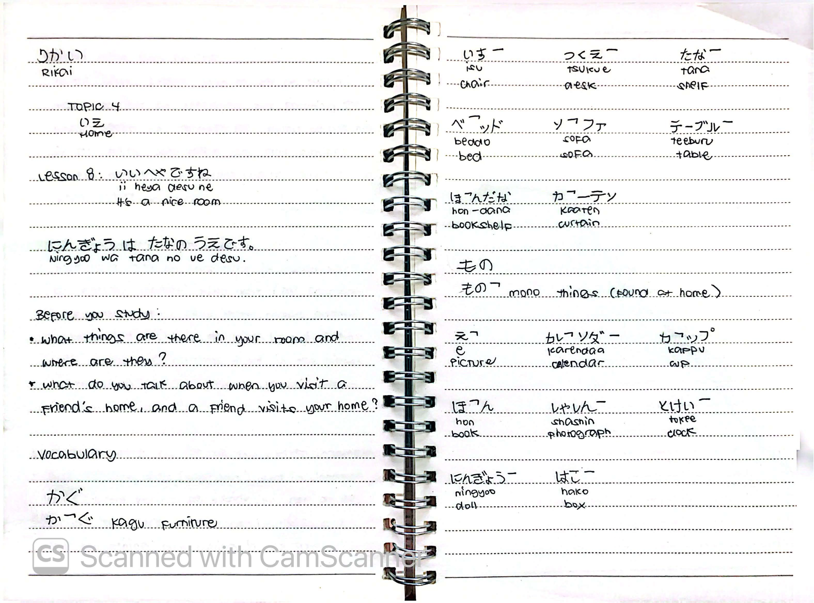

# 🎌 Rikai Lesson 8: いいへやですね (Ii heya desu ne)

**Course:** Marugoto A1-1 (Katsudoo & Rikai)
**Topic:** Topic 4 — いえ (Ie - Home)
**Mode:** りかい (Rikai)
**Status:** 🚧 In Progress

---

## 🎯 Can-Do Objective
**Can-do:** Describe where things are in a room.
**Goal:** へやに なにが あるか、どこに あるか いいます (Say what is in a room and where it is)

---

## 🗣️ Basic Sentences

| Japanese | Romaji | English |
| :--- | :--- | :--- |
| にんぎょうは たなの うえです。 | *Ningyoo wa tana no ue desu.* | The doll is on top of the shelf. |

---

## 📦 Vocabulary

### Furniture (かぐ)
| Japanese | Romaji | English |
| :--- | :--- | :--- |
| かぐ | *kagu* | furniture |
| いす | *isu* | chair |
| つくえ | *tsukue* | desk |
| たな | *tana* | shelf |
| ベッド | *beddo* | bed |
| ソファ | *sofa* | sofa |
| テーブル | *teeburu* | table |
| ほんだな | *hon-dana* | bookshelf |
| カーテン | *kaaten* | curtain |

### Things (もの)
| Japanese | Romaji | English |
| :--- | :--- | :--- |
| もの | *mono* | things (found at home) |
| え | *e* | picture |
| カレンダー | *karendaa* | calendar |
| カップ | *kappu* | cup |
| ほん | *hon* | book |
| しゃしん | *shashin* | photograph |
| とけい | *tokee* | clock / watch |
| にんぎょう | *ningyoo* | doll |
| はこ | *hako* | box |

### Rooms & Parts of a House (へや)
| Japanese | Romaji | English |
| :--- | :--- | :--- |
| へや | *heya* | room |
| げんかん | *genkan* | entrance |
| トイレ | *toire* | toilet |
| おふろ | *ofuro* | bathroom / bath |
| だいどころ | *daidokoro* | kitchen |
| いま | *ima* | living room |
| リビング | *ribingu* | living room |
| ベッドルーム | *beddo-rumu* | bedroom |
| にわ | *niwa* | garden |
| まど | *mado* | window |
| ドア | *doa* | door |
| かいだん | *kaidan* | staircase |
| ベランダ | *beranda* | balcony |
| かべ | *kabe* | wall |
| ろうか | *rouka* | corridor |

---

## 🧠 Vocabulary Categories (Notes)

*   **Things vs. Rooms:** 「にんぎょう」 (doll) and 「とけい」 (watch) are names of **things**. 「だいどころ」 (kitchen) is the name of a **room**.
*   **Furniture vs. Not Furniture:** 「テーブル」 (table) and 「いす」 (chair) are **furniture** (かぐ). 「しゃしん」 (photograph) is **not** furniture.
*   **Inside vs. Outside:** 「おふろ」 (bathroom) and 「へや」 (bedroom/room) are **inside** the house. 「にわ」 (garden) is **outside** the house.

---

## 🧠 Before You Study

Think about these questions:
* What things are there in your room and where are they?
* What do you talk about when you visit a friend's home, and a friend visits your home?

---

## 📝 Study Log & Additional Notes

- **2026-11-20:** Started Rikai Lesson 8. Learned furniture and household object vocabulary, and how to say where an object is located.
- **2026-11-21:** Continued Rikai Lesson 8. Expanded vocabulary to include rooms, parts of a house (doors, windows, walls), and categorical rules (things vs rooms, inside vs outside).

---

## 📸 Handwritten Notes (Appendix)
> *Scanned pages from my physical study notebook.*

**Page 1 — Vocabulary & Location Sentence**

**Page 2 — House Map & Room Vocabulary**
